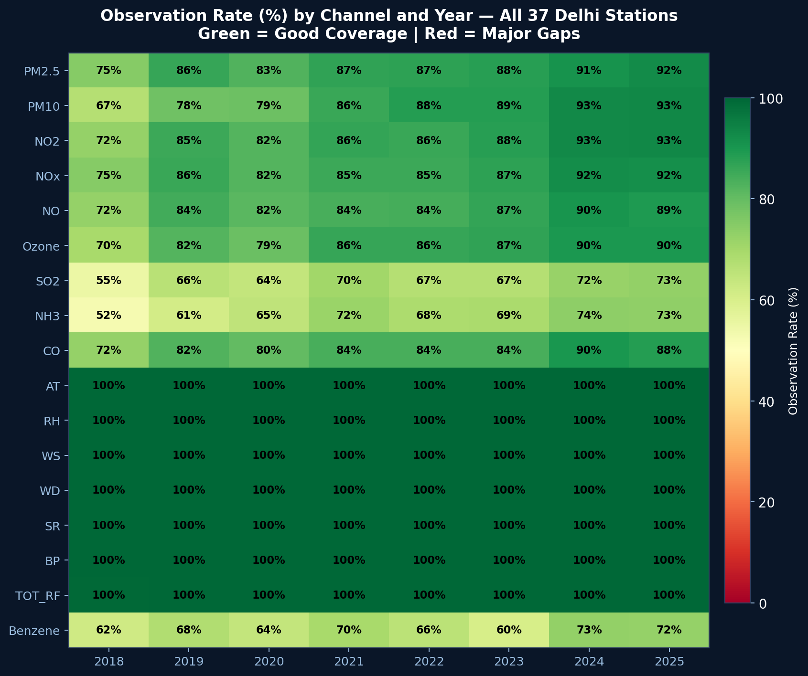
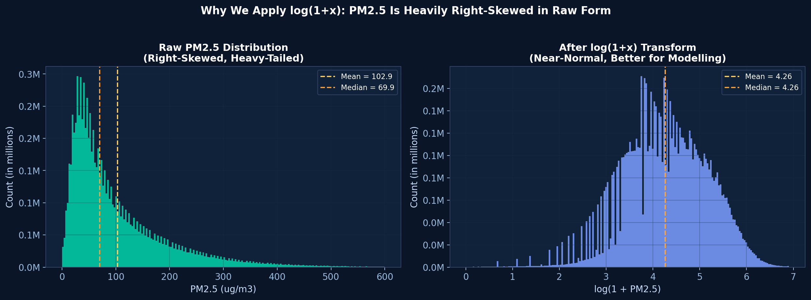
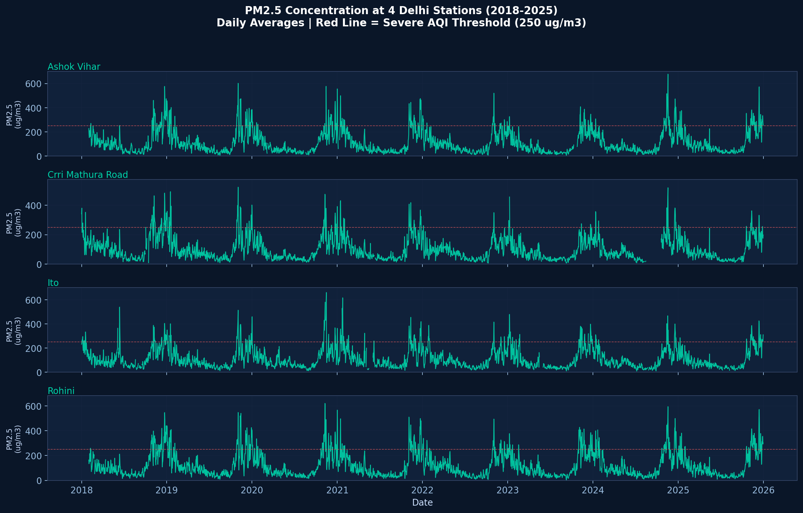
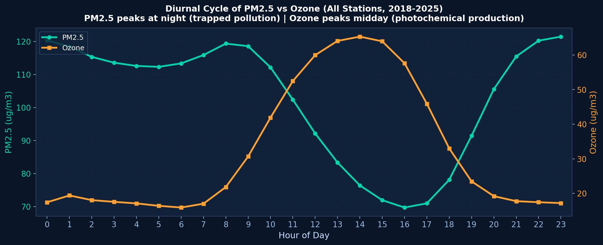
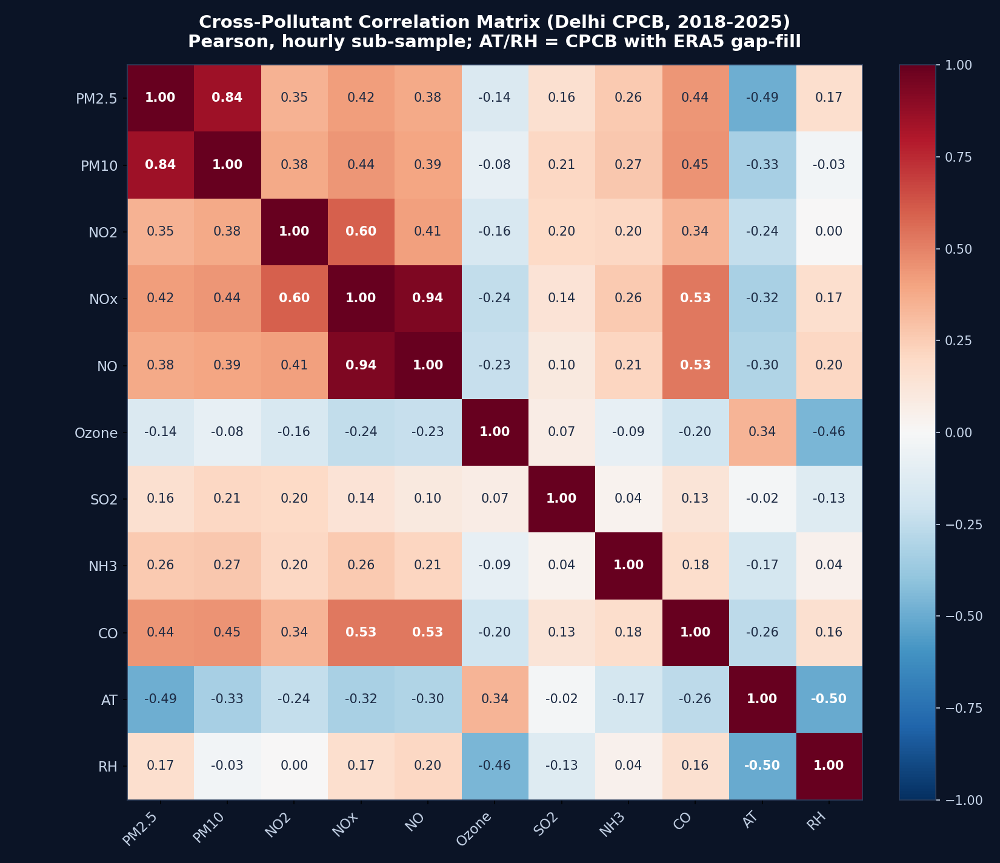
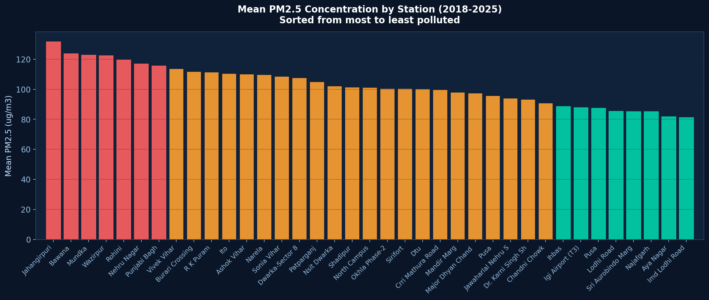

# AQFM Data Report: Delhi Air Quality and Weather, 2018–2025

**Document date:** 11 October 2026
**Scope:** every dataset used by the project: where it comes from, how it was processed, how complete it is, what it shows, and what is still wrong with it.
**How the numbers were produced:** unless noted otherwise, every number below was computed on 11 October 2026 directly from the model-ready arrays in `data/preprocessed/` (built 8 October 2026) and from `preprocessing_report.json`. Pollutant statistics use **only real observed readings** (`observed.npy == 1`), pooled over all stations and 15-minute steps.
**To reproduce:** `python docs/data_report_stats.py` recomputes every number in this report and writes them to `docs/data_report_stats.json`. It is deterministic.

Companion documents: [PROJECT_DOCUMENTATION.md](PROJECT_DOCUMENTATION.md) (whole project) and [BOTTLENECKS_AND_IMPROVEMENTS.md](BOTTLENECKS_AND_IMPROVEMENTS.md).

---

## 1. Summary

| Item | Value |
|---|---|
| Region | Delhi NCT, India (station box 28.48–28.85 °N, 76.99–77.31 °E; ~42 km across) |
| Period used | 1 Jan 2018 00:00 → 31 Dec 2025 23:45 IST |
| Time step | 15 minutes → **280,512 steps** |
| Stations | **37** with data (38 listed in `data/stations.csv`; `alipur` has no CSV files) |
| Channels stored | **18**: 9 pollutants, 7 weather, Benzene, boundary-layer height (BLH) |
| Final array | `values.npy`: **37 × 18 × 280,512** (plus an identical-shaped `observed.npy` mask) |
| Observed PM2.5 readings | **8,940,911** (86.1% of all station-steps) |
| Mean PM2.5 | **102.9 µg/m³**, about 3.4× the top of the "Good" band |
| Readings in the Severe band (PM2.5 ≥ 250) | **8.1%** overall; **31.2% in November** |
| Splits | train 2018–2023 · validation 2024 · **test 2025** |

## 2. Data sources

### 2.1 CPCB ground stations (air quality and local weather)

- **Publisher:** Central Pollution Control Board (CPCB), India. Stations are operated by CPCB, DPCC (Delhi Pollution Control Committee) and IITM (Indian Institute of Tropical Meteorology).
- **Files:** one CSV per station per year in `data/yearly_data/<year>/`, ~1.8 GB in total. Timestamps are in local time (IST).
- **Inventory (CSV files per year):**

| Year | 2009 | 2010 | 2011–2016 | 2017 | 2018 | 2019 | 2020 | 2021 | 2022 | 2023 | 2024 | 2025 | 2026 (partial) |
|---|---|---|---|---|---|---|---|---|---|---|---|---|---|
| Files | 5 | 6 | 9 each | 36 | 35 | 36 | 36 | 37 | 36 | 37 | 37 | 37 | 35 |

Only **2018–2025** is used. Before 2017 there are at most 9 stations, which is too few for a spatial model. 2026 is partial and is not used yet (it could become a second test year; see the bottlenecks document).

- **Columns** (example: ITO, 2023): `Station, Timestamp, PM2.5 (µg/m³), PM10 (µg/m³), NO (µg/m³), NO2 (µg/m³), NOx (ppb), NH3 (µg/m³), SO2 (µg/m³), CO (mg/m³), Ozone (µg/m³), Benzene (µg/m³), Toluene, Xylene, O Xylene, Eth-Benzene, MP-Xylene, AT (°C), RH (%), WS (m/s), WD (deg), RF (mm), TOT-RF (mm), SR (W/mt2), BP (mmHg), VWS (m/s)`.
  - Units are **not consistent across columns**: NO and NO2 are in µg/m³ but NOx is in **ppb**; CO is in **mg/m³**; and "BP (mmHg)" is often actually hPa (see §6).

### 2.2 Station coordinates

- `data/stations.csv`: `station_id, lat, lon`, 38 rows. The coordinates were obtained by **geocoding station names** with OpenStreetMap Nominatim (`data_pipeline/generate_stations_csv.py`). They are not official CPCB coordinates.
- **Problem:** three stations could not be geocoded and received the script's default "Delhi centre" fallback (28.6139, 77.209). See §6.1.

### 2.3 ERA5 reanalysis (weather)

- **Publisher:** ECMWF, through the Copernicus Climate Data Store (`reanalysis-era5-single-levels`).
- **Download:** monthly NetCDF files for the box 28.2–29.0 °N, 76.5–77.5 °E, hourly, **2017-01 → 2025-12 (100 files, 35 MB)**. December 2017 is needed so that 2018-01-01 00:00 IST (= 2017-12-31 18:30 UTC) is covered.
- **Variables (8):** 2 m temperature, 2 m dew point, 10 m u and v wind, surface solar radiation downwards, surface pressure, total precipitation, **boundary-layer height**.
- **Processing:** bilinear interpolation to each station → hourly upsampled to 15-minute (only within-hour slots filled) → `data/era5_interpolated.parquet` (730 MB) → shifted UTC → IST and converted to CPCB units during preprocessing.

| ERA5 variable | Becomes | Conversion |
|---|---|---|
| t2m (K) | AT (°C) | − 273.15 |
| d2m + t2m | RH (%) | Magnus formula |
| u10, v10 (m/s) | WS, WD and U, V | speed = √(u² + v²); direction the wind comes FROM |
| sp (Pa) | BP (mmHg) | ÷ 133.322 |
| ssrd (J/m² per hour) | SR (W/m²) | ÷ 3600 |
| tp (m) | TOT_RF (mm) | × 1000 |
| blh (m) | BLH (m) | none |

## 3. Processing pipeline (how raw data became arrays)

| Step | Script | Output | Key facts |
|---|---|---|---|
| 0 | `generate_stations_csv.py` | `stations.csv` | geocoded, one-off |
| 1 | `fetch_era5.py` | `era5_data_raw/*.nc` | ~8 min per month on the CDS queue |
| 2 | `fix_era5_zips.py` | same files, unpacked | CDS returns zip archives named `.nc` |
| 3 | `interpolate_era5_to_stations.py` | `era5_interpolated.parquet` | bilinear, 15-min, never bridges missing months |
| 4 | `preprocess_aqfm.py` | `preprocessed/*.npy` + report | ~2.5 min; steps below |

Inside `preprocess_aqfm.py`:
1. **Align** every CSV to one 15-minute grid; average duplicate timestamps.
2. **Fix BP units:** readings > 900 treated as hPa and converted (**5,410,316 readings**).
3. **Merge ERA5:** shift +5 h 30 min to IST; fill only where the CPCB weather sensor is missing; append BLH as channel 18; save pure ERA5 separately as `era5_met.npy`.
4. **Sanity bounds:** out-of-range readings are set to missing (bounds in §6.3).
5. **Static features:** 4 per station.
6. **Report:** `preprocessing_report.json`.

Final verification gates (8 October 2026, all passed): shapes correct; mask binary; no NaN; timestamps monotonic at exactly 0.25 h; `era5_met` 0% NaN; solar radiation peaks at hour 12 IST; all station BP medians are 733–742 mmHg.

## 4. Channels and completeness

### 4.1 The 18 stored channels

| # | Channel | Unit | Source | Observed (2018–2025) |
|---|---|---|---|---|
| 0 | PM2.5 | µg/m³ | CPCB | 86.1% |
| 1 | PM10 | µg/m³ | CPCB | 84.1% |
| 2 | NO2 | µg/m³ | CPCB | 85.8% |
| 3 | NOx | ppb | CPCB | 85.5% |
| 4 | NO | µg/m³ | CPCB | 84.1% |
| 5 | Ozone | µg/m³ | CPCB | 83.6% |
| 6 | SO2 | µg/m³ | CPCB | 66.8% |
| 7 | NH3 | µg/m³ | CPCB | 66.8% |
| 8 | CO | mg/m³ | CPCB | 83.1% |
| 9 | AT (air temperature) | °C | CPCB, gaps filled from ERA5 | 100% (57.2% native) |
| 10 | RH (relative humidity) | % | CPCB + ERA5 | 100% (69.4% native) |
| 11 | WS (wind speed) | m/s | CPCB + ERA5 | 100% (68.5% native) |
| 12 | WD (wind direction) | degrees | CPCB + ERA5 | 100% (68.5% native) |
| 13 | SR (solar radiation) | W/m² | CPCB + ERA5 | 100% (66.9% native) |
| 14 | BP (pressure) | mmHg | CPCB + ERA5 | 100% (57.1% native) |
| 15 | TOT_RF (rainfall) | mm | CPCB + ERA5 | 99.9% (90.2% native) |
| 16 | Benzene | µg/m³ | CPCB | 66.8% |
| 17 | BLH (boundary-layer height) | m | ERA5 only | 100% |

"Native" is the share of readings that came from the station's own sensor before ERA5 gap-filling (= 1 − gaps ÷ all station-steps). This matters because the weather channels mix two data sources (§6.4).

### 4.2 Coverage improves over time

PM2.5 observed share by year:

| 2018 | 2019 | 2020 | 2021 | 2022 | 2023 | 2024 | 2025 |
|---|---|---|---|---|---|---|---|
| 74.7% | 86.1% | 82.6% | 87.0% | 87.3% | 88.1% | 91.0% | 92.4% |

The pattern is similar for every pollutant: 2018 is the weakest year, and SO2, NH3 and Benzene are the least complete channels (~67%).

*Figure: observation rate by channel and year. The weather rows show 100% because they are ERA5 gap-filled; see the "native" column in §4.1 for true sensor coverage.*

### 4.3 Station outages

A station is counted as "out" when fewer than half of its 9 pollutant analysers report. Statistics are for the training years (2018–2023):

| Statistic | Value |
|---|---|
| All outage events | 96,659, of which **92.6% last ≤ 1 hour** (median 0.5 h; mostly 1–2-step glitches) |
| Outages ≥ 4 h (one model patch) | **3,033** |
| Median length of those | **10.8 h** (log-normal fit: μ = 3.932, σ = 1.030 in 15-min steps → median 12.8 h) |
| 90th percentile | 42.8 h |
| Outages ≥ 1 day / ≥ 1 week | 552 / 58 |
| Longest | 1,096 days (a station that had not yet started operating) |

The model's "block masking" training simulates outages with the fitted ≥ 4 h distribution. The older figure of 0.5 h in `preprocessing_report.json` includes the glitches and is **not** used.

## 5. What the data shows

### 5.1 Distribution of pollutants

| Pollutant (unit) | 5th pct | 25th | **Median** | 75th | 95th | 99th | Mean |
|---|---|---|---|---|---|---|---|
| PM2.5 (µg/m³) | 15.9 | 38.0 | **69.9** | 136.1 | 296.0 | 458.0 | 102.9 |
| PM10 (µg/m³) | 41.0 | 100.0 | **172.0** | 277.2 | 497.0 | 708.0 | 207.7 |
| NO2 (µg/m³) | 6.2 | 17.0 | **30.4** | 52.9 | 106.7 | 169.8 | 40.4 |
| NOx (ppb) | 7.3 | 16.6 | **29.9** | 57.2 | 172.0 | 328.0 | 50.6 |
| NO (µg/m³) | 1.4 | 4.2 | **9.7** | 27.8 | 141.9 | 308.0 | 30.8 |
| Ozone (µg/m³) | 2.5 | 8.6 | **19.5** | 41.9 | 109.7 | 164.4 | 32.3 |
| CO (mg/m³) | 0.2 | 0.6 | **1.0** | 1.6 | 3.5 | 5.9 | 1.3 |
| SO2 (µg/m³) | 1.9 | 5.5 | **9.8** | 16.3 | 33.0 | 58.0 | 12.7 |
| NH3 (µg/m³) | 11.9 | 24.3 | **35.0** | 50.1 | 88.6 | 140.5 | 41.0 |
| Benzene (µg/m³) | 0.0 | 0.3 | **1.3** | 3.3 | 10.0 | 20.3 | 2.7 |

All pollutants are **strongly right-skewed** (mean ≫ median, long upper tail). This is why the model works in `log(1 + x)` space and predicts log-normal mixtures.

### 5.2 How often each AQI band occurs (PM2.5, all observed readings)

| Good (0–30) | Satisfactory (30–60) | Moderate (60–90) | Poor (90–120) | Very Poor (120–250) | **Severe (≥ 250)** |
|---|---|---|---|---|---|
| 17.4% | 26.4% | 16.1% | 10.6% | 21.4% | **8.1%** |

Severe readings are rare overall, which is why a pooled average error can look good while severe days are badly forecast.

### 5.3 Seasonality: winter is the problem

Mean concentration (µg/m³) and share of Severe PM2.5 readings by month:

| Month | Jan | Feb | Mar | Apr | May | Jun | Jul | Aug | Sep | Oct | **Nov** | Dec |
|---|---|---|---|---|---|---|---|---|---|---|---|---|
| PM2.5 | 178.7 | 118.2 | 81.8 | 78.1 | 73.5 | 56.6 | 37.7 | **33.9** | 40.3 | 110.9 | **215.5** | 197.1 |
| PM10 | 282.5 | 227.0 | 190.1 | 216.5 | 200.7 | 172.1 | 93.7 | 91.3 | 102.3 | 234.0 | **352.9** | 318.7 |
| % Severe | 19.9 | 5.8 | 1.4 | 1.9 | 1.5 | 0.6 | 0.1 | 0.0 | 0.1 | 6.2 | **31.2** | 25.7 |

| Season | Mean PM2.5 | Median PM2.5/PM10 ratio |
|---|---|---|
| Winter (Dec–Feb) | 166.2 | **0.60** (fine particles dominate) |
| Pre-monsoon (Mar–May) | 77.9 | 0.38 (dust: coarse particles) |
| Monsoon (Jun–Sep) | 42.1 | 0.38 |
| Post-monsoon (Oct–Nov) | 163.3 | 0.54 |

**November PM2.5 is about 6× August.** The PM2.5/PM10 ratio also changes with season: winter pollution is mostly fine combustion particles, while spring has more coarse dust. This seasonal ratio is exactly what the model's `PM_FRAC` channel learns.

### 5.4 Daily cycle

Mean PM2.5 by hour of day (IST):

| Hour | 00 | 03 | 06 | 08 | 12 | 14 | **16** | 18 | 20 | **23** |
|---|---|---|---|---|---|---|---|---|---|---|
| PM2.5 | 120.3 | 113.6 | 113.4 | 119.4 | 92.2 | 76.4 | **69.7** | 78.1 | 105.6 | **121.5** |
| ERA5 BLH (m)* | 122 | 124 | 142 | — | 1,222 | — | — | 296 | — | 121 (21 h) |

\*BLH sampled at 00/03/06/12/18/21 h.

PM2.5 is **lowest in the afternoon (~16:00), when the boundary layer is deepest** (over 1,200 m, so pollution mixes upward), and **highest late at night**, when the boundary layer collapses to ~120 m and traps emissions near the ground. This is the physical reason BLH is included as an input.

### 5.5 Weather drivers

**Spearman rank correlation with PM2.5** (hourly sub-sample, all stations, observed points only):

| Variable | ρ | Interpretation |
|---|---|---|
| PM10 | **+0.86** | same sources, same weather |
| CO | +0.43 | combustion |
| NO2 | +0.43 | traffic and combustion |
| Air temperature (ERA5) | **−0.57** | cold = winter = inversions |
| **BLH (ERA5)** | **−0.41** | shallow mixing layer traps pollution |
| Ozone | −0.20 | ozone is photochemical (sunny, cleaner afternoons) |
| Wind speed (ERA5) | −0.18 | wind disperses pollution |
| Relative humidity (ERA5) | +0.09 | weak |

**Boundary-layer height:** 5th percentile 24 m, median 204 m, 95th percentile 1,809 m. Seasonal mean: winter 284 m, pre-monsoon 691 m, monsoon 553 m, post-monsoon 365 m.

*Figure: Pearson correlation matrix, regenerated on 11 Oct 2026 from the fixed data with `docs/figures/make_correlation_heatmap.py`. The pollutant-to-pollutant values are identical to the September version. The AT and RH rows changed because the old figure predated the ERA5 fixes: PM2.5 vs AT is now −0.49.*

### 5.6 Year-to-year

| Year | 2018 | 2019 | 2020 | 2021 | 2022 | 2023 | 2024 | 2025 |
|---|---|---|---|---|---|---|---|---|
| Mean PM2.5 | 112.3 | 108.8 | **96.0** | 105.8 | 98.7 | 101.8 | 104.3 | 97.1 |

The 2020 dip coincides with the COVID-19 lockdowns. Emissions that year were abnormal, which is a known risk for training (see the bottlenecks document).

### 5.7 Stations

**Spatial layout:** pairwise distances range from 0 km (stations sharing coordinates) to 42.4 km, median 13.3 km. The median nearest neighbour is 2.5 km away; in a 12-station neighbourhood (the model's sample size) the farthest neighbour is a median 8.3 km away.

Ranked by mean PM2.5 (all observed readings, 2018–2025). "Coverage" is the share of 2018–2025 steps with an observed PM2.5. ⚠️ marks the fallback coordinates (§6.1).

| Rank | Station (operator) | Lat, Lon | First PM2.5 year | PM2.5 coverage | Mean PM2.5 |
|---|---|---|---|---|---|
| 1 | Jahangirpuri (DPCC) | 28.726, 77.1627 | 2018 | 85.6% | 131.7 |
| 2 | Bawana (DPCC) | 28.7997, 77.0329 | 2019 | 84.1% | 123.7 |
| 3 | Mundka (DPCC) | 28.6824, 77.0306 | 2018 | 89.5% | 122.7 |
| 4 | Wazirpur (DPCC) | 28.6801, 77.1702 | 2018 | 94.2% | 122.5 |
| 5 | Rohini (DPCC) | 28.7063, 77.1088 | 2018 | 86.9% | 119.5 |
| 6 | Nehru Nagar (DPCC) | 28.5685, 77.2514 | 2018 | 95.8% | 117.0 |
| 7 | Punjabi Bagh (DPCC) | 28.673, 77.1461 | 2018 | 93.8% | 115.6 |
| 8 | Vivek Vihar (DPCC) | 28.6692, 77.3123 | 2018 | 93.4% | 113.5 |
| 9 | Burari Crossing (IITM) | 28.7286, 77.1993 | 2018 | 62.3% | 111.7 |
| 10 | R K Puram (DPCC) | 28.5504, 77.1855 | 2018 | 90.2% | 111.2 |
| 11 | ITO (CPCB) | 28.6282, 77.241 | 2018 | 88.9% | 110.3 |
| 12 | Ashok Vihar (DPCC) | 28.6885, 77.1739 | 2018 | 93.6% | 109.9 |
| 13 | Narela (DPCC) | 28.8465, 77.0857 | 2018 | 93.5% | 109.5 |
| 14 | Sonia Vihar (DPCC) | 28.7199, 77.2482 | 2018 | 94.4% | 108.5 |
| 15 | Dwarka Sector 8 (DPCC) | 28.5656, 77.067 | 2021 | 48.8% | 107.4 |
| 16 | Patparganj (DPCC) | 28.6116, 77.2906 | 2018 | 95.2% | 104.9 |
| 17 | NSIT Dwarka (CPCB) | 28.6139, 77.209 ⚠️ | 2018 | 94.1% | 102.0 |
| 18 | Shadipur (CPCB) | 28.6516, 77.1583 | 2018 | 93.1% | 101.2 |
| 19 | North Campus DU (IITM) | 28.6891, 77.2135 | 2018 | 91.5% | 101.0 |
| 20 | Okhla Phase-2 (DPCC) | 28.5375, 77.2779 | 2018 | 96.2% | 100.4 |
| 21 | Sirifort (CPCB) | 28.5502, 77.2249 | 2018 | 85.8% | 100.3 |
| 22 | DTU (CPCB) | 28.7508, 77.1163 | 2018 | 89.0% | 100.2 |
| 23 | CRRI Mathura Road (IITM) | 28.5501, 77.2752 | 2018 | 93.1% | 99.5 |
| 24 | Mandir Marg (DPCC) | 28.6327, 77.1996 | 2018 | 89.4% | 97.8 |
| 25 | Major Dhyan Chand National Stadium (DPCC) | 28.6126, 77.2373 | 2018 | 95.7% | 97.2 |
| 26 | Pusa (DPCC) | 28.6363, 77.1576 | 2018 | 88.8% | 95.6 |
| 27 | Jawaharlal Nehru Stadium (DPCC) | 28.5834, 77.2335 | 2018 | 94.2% | 93.8 |
| 28 | Dr. Karni Singh Shooting Range (DPCC) | 28.5001, 77.2675 | 2018 | 91.2% | 93.1 |
| 29 | Chandni Chowk (IITM) | 28.656, 77.2322 | 2020 | 34.4% | 90.7 |
| 30 | IHBAS, Dilshad Garden (CPCB) | 28.6139, 77.209 ⚠️ | 2018 | 86.6% | 88.5 |
| 31 | IGI Airport T3 (IITM) | 28.5552, 77.0904 | 2018 | 90.2% | 87.8 |
| 32 | Pusa (IITM) | 28.6363, 77.1576 | 2018 | 88.0% | 87.4 |
| 33 | Lodhi Road (IITM) | 28.5908, 77.2263 | 2020 | 31.8% | 85.4 |
| 34 | Najafgarh (DPCC) | 28.6124, 76.9865 | 2018 | 90.4% | 85.2 |
| 35 | Sri Aurobindo Marg (DPCC) | 28.5396, 77.2 | 2018 | 90.5% | 85.2 |
| 36 | Aya Nagar (IITM) | 28.4765, 77.1329 | 2018 | 90.7% | 81.8 |
| 37 | IMD Lodhi Road (IITM) | 28.6139, 77.209 ⚠️ | 2018 | 92.2% | 81.2 |

North-west industrial and residential areas (Jahangirpuri, Bawana, Mundka, Wazirpur, Rohini) are the most polluted. Southern and greener sites (Aya Nagar, Sri Aurobindo Marg, Lodhi Road) are the least. Four stations have low coverage because they started late or have long gaps: Lodhi Road IITM 31.8%, Chandni Chowk 34.4%, Dwarka Sector 8 48.8%, Burari Crossing 62.3%.

*Figure: mean PM2.5 by station (despite the file name `station_map.png`, this is a bar chart, not a map).*

### 5.8 Static station features (`static.npy`, 37 × 4)

| # | Feature | Computed from |
|---|---|---|
| 0 | Mean log(1 + PM2.5) | first 7/8 of the timeline (≈ 2018–2024) |
| 1 | Mean PM2.5/PM10 ratio | same |
| 2 | Elevation proxy: (mean BP − 760) / 10 | same |
| 3 | Number of stations within 5 km | coordinates |

All four are standardised across stations. Feature 3 was broken until 11 Oct 2026 (§6.2).

## 6. Data-quality issues

### 6.1 ⚠️ Open: three stations have wrong coordinates

`IHBAS Dilshad Garden`, `IMD Lodhi Road` and `NSIT Dwarka` all have **exactly (28.6139, 77.209)**. This is the fallback that `generate_stations_csv.py` writes when geocoding fails. From general geography, NSIT Dwarka is in south-west Delhi and IHBAS is in east Delhi, so both are several kilometres or more from that point. These distances are approximate and should be confirmed against CPCB's official station list.

Effects:
- The model treats the three as **one location** (distance 0, so the wind-bearing term is undefined), and their nearest-neighbour sets are wrong.
- Their ERA5 weather is interpolated at the wrong point. The effect is limited because ERA5's grid is ~25 km.
- Static feature 3 (station density) is also affected.

Separately, **Pusa (DPCC)** and **Pusa (IITM)** share one coordinate. They are probably on the same campus, so this is likely acceptable, but it should be checked.

**Fix:** replace the three rows in `data/stations.csv` with official coordinates, then re-run interpolation and preprocessing.

**Decision (11 Oct 2026):** left as is for now. The impact is nil for the baselines, which do not use coordinates. For AQFM it affects the spatial attention of 3 of 37 stations; it will not break training, but it should be corrected before the final paper runs.

### 6.2 ✅ Fixed 11 Oct 2026: station-density static feature was empty

In `compute_static_features()` (`data_pipeline/preprocess_aqfm.py`), the density loop iterated over `i` but wrote to `static[si, 3]`, where `si` was left over from the previous loop and equalled the last station. So **36 of 37 stations got 0** and the last (Wazirpur) got 4, and the standardisation step skipped the column. Fixed to `static[i, 3]` and preprocessing re-run. All 37 stations now have a standardised value; static features 0–2 and every other array are byte-identical to before. The feature still inherits the coordinate problem in §6.1.

### 6.3 Handled: impossible values, units, ceilings

| Check | Result |
|---|---|
| Physical bounds (PM2.5 0–2000, PM10 0–3000, CO 0–30, AT −15–55 °C, RH 0–100, BP 600–1100, …) | Clipped to missing: CO 548, Benzene 551, AT 60, SR 301, TOT_RF 7,167 readings |
| BP labelled mmHg but actually hPa | 5,410,316 readings converted; station medians now 733–742 mmHg |
| PM2.5 > PM10 (physically impossible) | 36,914 cells, **0.43%** of pairs. Kept; the model's fraction is clipped to [0.01, 0.99] |
| NO + NO2 vs NOx | Units differ (µg/m³ vs ppb). After converting to ppb, (NO + NO2) / NOx has a pooled median of 0.999, and **26 of 36 stations** have a median within ±1%. But **8 stations** (Aya Nagar, Burari Crossing, CRRI Mathura Road, IGI Airport T3, IMD Lodhi Road, North Campus, Pusa IITM, Rohini) sit at 0.66–0.71, i.e. NO + NO2 is only about two-thirds of NOx; the cause is unknown. The model therefore uses the NO fraction only where the identity holds to within 10% (54.8% coverage) |
| **Analyser ceilings** | PM2.5 and PM10 maxima are exactly 1000 µg/m³ (168 and 1,827 readings at exactly 1000). NOx, NO, NO2, NH3 and Ozone top out at ~500 and SO2 at 200. These look like **instrument range limits**, so the most extreme readings are probably truncated. **The effect on the test metrics is negligible:** in 2025 only 7 of 88,081 severe PM2.5 readings (and 149 of 334,347 severe PM10 readings) sit at the cap, and none of the 1,252 severe 24 h scoring points do. Worth one sentence in the paper. |

### 6.4 Design caveat: weather mixes two sources

Channels AT, RH, WS, WD, SR, BP and TOT_RF contain the station's own sensor where it exists and ERA5 elsewhere, and both are marked `observed = 1`. The model therefore cannot tell a local measurement from a 25 km reanalysis value, and the two can differ systematically (for example, an urban heat island in AT). The separate pure-ERA5 array (`era5_met.npy`) is what the model uses for future weather.

### 6.5 Fixed earlier (history)

| Issue | Status |
|---|---|
| ERA5 for Apr 2017 – Dec 2020 was never downloaded and was linearly interpolated across the 3.75-year gap (fake weather) | Fixed: downloaded; interpolation can no longer bridge gaps |
| ERA5 (UTC) aligned to CPCB (IST) without a time shift (5.5 h phase error) | Fixed: +5:30 shift; SR now peaks at 12:00 |
| Preprocessing ran out of memory reading the full parquet | Fixed: per-station reads |

## 7. Files and sizes

| Path | Size | Tracked in git |
|---|---|---|
| `data/yearly_data/` | 1,786 MB | no |
| `data/era5_data_raw/` | 35 MB | no |
| `data/era5_interpolated.parquet` | 730 MB | no |
| `data/preprocessed/` | 1,829 MB (values 747, observed 747, era5_met 332) | no |
| `data/stations.csv` | < 4 KB | yes |
| `docs/figures/` | 7 PNG figures | yes |

To rebuild everything from raw data, see §13 of [PROJECT_DOCUMENTATION.md](PROJECT_DOCUMENTATION.md).
