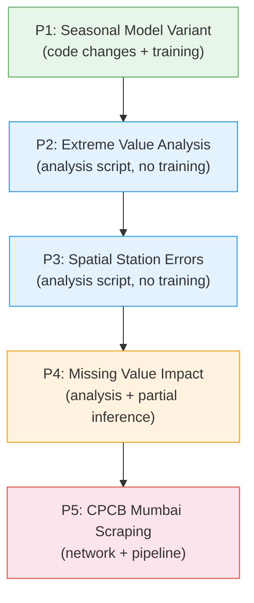

# AQFM v3 Enhancements — Detailed Implementation Plan

## Goal

Five new work items for the AQFM project, ordered by priority. Each is specified at the level of exact files, functions, arguments, code patterns, and verification steps so that an executing agent can carry them out without ambiguity.

> [!IMPORTANT]
> **Decisions already made by the user:**
> - **Season mapping**: India-specific (winter=Nov–Feb, summer=Mar–May, monsoon=Jun–Sep, post-monsoon=Oct). No meteorological DJF/MAM/JJA/SON.
> - **Mumbai date range**: Try 2018–2025 (matching Delhi).
> - **CPCB access**: Public portal only — no API key or account.
> - **All effort estimates** are for code writing on the Windows laptop (CPU-only). GPU training (P1) and GPU inference (P4 analysis 3) happen separately on the RTX 4000 Ada machine.

---

## Priority 1: Seasonal-Aware Model Variant

### Background & Rationale

The current model learns time through `TimeFeatures` in [layers.py](file:///c:/Users/phala/Foundation%20Model/aqfm/layers.py#L54-L73): Fourier features with log-spaced periods from 3 h to 1 year, plus explicit 24 h / 168 h / 8766 h cycles. These are **implicit** — the model must learn from the data that winter pollution behaves differently from monsoon pollution. It has no **explicit** season label.

Delhi has 4 distinct air-quality regimes:
- **Winter** (Nov–Feb): worst PM2.5, temperature inversions, low BLH
- **Summer** (Mar–May): dust storms, high PM10
- **Monsoon** (Jun–Sep): rain washout, lowest PM
- **Post-monsoon** (Oct): crop-burning spike, transition

The existing v2-M PM2.5 24 h MAE is 32.26 (ensemble, 2025 test). The Severe-band MAE is 87.9. Extreme errors cluster in winter transitions (Oct–Nov, Feb–Mar). An explicit season signal could help the model specialise its uncertainty and bias correction for these regimes.

### Design

> [!IMPORTANT]
> This is an **additional variant**, not a replacement. The existing model stays unchanged so all prior results remain valid. The new variant is called **v2-M-S** ("seasonal").

**Approach: Season embedding added to the query decoder and patch tokenizer.**

A new config field `use_season: bool = False` (default False → v1/v2 unchanged). When True:
1. A `season_emb = nn.Embedding(4, d_model)` is added to the model.
2. Each sample carries a `season` integer (0–3) derived from the month of its **forecast origin** (the boundary between context and horizon).
3. The season embedding is added to:
   - Every **patch token** in the tokenizer (after the time/station/channel embeddings).
   - Every **decoder query** (alongside lead, time, channel, station embeddings).
4. The `season` index is computed as: `month_of_origin → {12,1,2: 0 (winter), 3,4,5: 1 (summer), 6,7,8,9: 2 (monsoon), 10,11: 3 (post-monsoon)}`.

**Why an embedding, not Fourier features?** The Fourier features already encode annual periodicity continuously. The point of the season embedding is a **discrete regime switch** — a separate learned bias for each regime, so the model can shift its mean and variance differently in winter vs monsoon. A continuous feature cannot do this as sharply.

### Files to Change — Exact Diffs

---

#### Step 1.1: [MODIFY] `aqfm/config.py`

**Change A** — Add `datetime` import (line 8):

```python
# BEFORE (line 8-9):
from dataclasses import dataclass
from typing import Optional, Tuple

# AFTER:
from dataclasses import dataclass
from datetime import datetime
from typing import Optional, Tuple
```

**Change B** — Add `MONTH_TO_SEASON` and `EPOCH` constants (after line 44, the `NOX_PAIR` line):

```python
# BEFORE (lines 43-44):
PM_PAIR = ("PM10", "PM_FRAC")       # PM2.5 = PM10 * sigmoid(frac)
NOX_PAIR = ("NOx", "NOX_FRAC")      # NO = NOx * f, NO2 = NOx * (1 - f), in ppb

# AFTER:
PM_PAIR = ("PM10", "PM_FRAC")       # PM2.5 = PM10 * sigmoid(frac)
NOX_PAIR = ("NOx", "NOX_FRAC")      # NO = NOx * f, NO2 = NOx * (1 - f), in ppb

# Month → season index (India-specific air-quality regimes)
# winter=0 (Nov–Feb), summer=1 (Mar–May), monsoon=2 (Jun–Sep), post-monsoon=3 (Oct)
MONTH_TO_SEASON = {12: 0, 1: 0, 2: 0, 3: 1, 4: 1, 5: 1,
                   6: 2, 7: 2, 8: 2, 9: 2, 10: 3, 11: 3}

EPOCH = datetime(2018, 1, 1)
```

**Change C** — Add `use_season` field to `AQFMConfig` (after line 141, `density_features`):

```python
# BEFORE (line 141):
    density_features: bool = False

# AFTER:
    density_features: bool = False
    use_season: bool = False           # True adds a 4-class season embedding (v2-M-S variant)
```

**Do NOT** set `use_season` in the `city()` or `small()` classmethods. The user enables it with `--season` on the command line.

---

#### Step 1.2: [MODIFY] `aqfm/model.py`

**Change A** — Update import (line 16):

```python
# BEFORE (line 16):
from .config import AQFMConfig, CH, OUTAGE_CHANNELS

# AFTER:
from .config import AQFMConfig, CH, OUTAGE_CHANNELS, EPOCH
```

> [!NOTE]
> `EPOCH` is imported here but only used by `data.py` (which imports from `config`). The model itself doesn't use `EPOCH`. This import change is optional — only add it if something in `model.py` needs it. In practice, **skip this import** in `model.py`; `EPOCH` is only needed in `data.py` and `train.py`.

**Change B** — `PatchTokenizer.__init__` (after line 115, `self.norm`):

```python
# BEFORE (lines 108-116):
class PatchTokenizer(nn.Module):
    def __init__(self, cfg: AQFMConfig):
        super().__init__()
        self.cfg = cfg
        self.value_proj = nn.Linear(2 * cfg.patch_len, cfg.d_model)
        self.channel_emb = nn.Embedding(cfg.n_channels, cfg.d_model)
        self.station = station_mlp(cfg)
        self.time = TimeFeatures(cfg.d_model, cfg.n_fourier_bands)
        self.gap_proj = nn.Linear(1, cfg.d_model)
        self.norm = nn.LayerNorm(cfg.d_model)

# AFTER:
class PatchTokenizer(nn.Module):
    def __init__(self, cfg: AQFMConfig):
        super().__init__()
        self.cfg = cfg
        self.value_proj = nn.Linear(2 * cfg.patch_len, cfg.d_model)
        self.channel_emb = nn.Embedding(cfg.n_channels, cfg.d_model)
        self.station = station_mlp(cfg)
        self.time = TimeFeatures(cfg.d_model, cfg.n_fourier_bands)
        self.gap_proj = nn.Linear(1, cfg.d_model)
        self.season_emb = nn.Embedding(4, cfg.d_model) if cfg.use_season else None
        self.norm = nn.LayerNorm(cfg.d_model)
```

**Change C** — `PatchTokenizer.forward` signature and body (lines 118-135):

```python
# BEFORE (lines 118-135):
    def forward(self, xn, m, t_patch, sf):
        """xn, m: (B,S,C,T) normalised values and visibility; t_patch: (B,N)
        patch-centre hours; sf: (B,S,n_station_in) station inputs. Returns
        tokens (B,S,C,N,D) and validity (B,S,C,N)."""
        B, S, C, T = xn.shape
        P = self.cfg.patch_len
        N = T // P
        xp = xn.reshape(B, S, C, N, P)
        mp = m.reshape(B, S, C, N, P)
        valid = mp.sum(-1) > 0
        gap_h = hours_since_prev_valid(valid, self.cfg.patch_hours)

        tok = self.value_proj(torch.cat([xp, mp], -1))
        tok = tok + self.channel_emb.weight[:C].view(1, 1, C, 1, -1)
        tok = tok + self.station(sf).view(B, S, 1, 1, -1)
        tok = tok + self.time(t_patch).view(B, 1, 1, N, -1)
        tok = tok + self.gap_proj(torch.log1p(gap_h).unsqueeze(-1))
        return self.norm(tok), valid

# AFTER:
    def forward(self, xn, m, t_patch, sf, season=None):
        """xn, m: (B,S,C,T) normalised values and visibility; t_patch: (B,N)
        patch-centre hours; sf: (B,S,n_station_in) station inputs;
        season: optional (B,) int tensor (0–3). Returns tokens (B,S,C,N,D)
        and validity (B,S,C,N)."""
        B, S, C, T = xn.shape
        P = self.cfg.patch_len
        N = T // P
        xp = xn.reshape(B, S, C, N, P)
        mp = m.reshape(B, S, C, N, P)
        valid = mp.sum(-1) > 0
        gap_h = hours_since_prev_valid(valid, self.cfg.patch_hours)

        tok = self.value_proj(torch.cat([xp, mp], -1))
        tok = tok + self.channel_emb.weight[:C].view(1, 1, C, 1, -1)
        tok = tok + self.station(sf).view(B, S, 1, 1, -1)
        tok = tok + self.time(t_patch).view(B, 1, 1, N, -1)
        tok = tok + self.gap_proj(torch.log1p(gap_h).unsqueeze(-1))
        if self.season_emb is not None and season is not None:
            tok = tok + self.season_emb(season).view(B, 1, 1, 1, -1)
        return self.norm(tok), valid
```

**Change D** — `AQFM.__init__`: Add `q_season` embedding (after line 227, `self.q_met`):

```python
# BEFORE (line 227):
        self.q_met = nn.Linear(cfg.n_met_future, cfg.d_model) if cfg.use_future_met else None

# AFTER:
        self.q_met = nn.Linear(cfg.n_met_future, cfg.d_model) if cfg.use_future_met else None
        self.q_season = nn.Embedding(4, cfg.d_model) if cfg.use_season else None
```

**Change E** — `AQFM.encode` signature (line 253):

```python
# BEFORE (line 253):
    def encode(self, x, m, t_patch, coords, static, sf=None):

# AFTER:
    def encode(self, x, m, t_patch, coords, static, sf=None, season=None):
```

And in the `encode` body, pass `season` to the tokenizer (line 260):

```python
# BEFORE (line 260):
        tok, valid = self.tokenizer(self.revin.normalize(x, m, mean, std), m, t_patch, sf)

# AFTER:
        tok, valid = self.tokenizer(self.revin.normalize(x, m, mean, std), m, t_patch, sf, season=season)
```

**Change F** — `AQFM.embed_queries` (lines 280-293): Add season to query embedding:

```python
# BEFORE (lines 286-287):
        e = (self.q_channel(q["slot"]) + self.q_task(q["task"]) + self.q_lead(q["lead"])
             + st + self.q_time(q["time"]))

# AFTER:
        e = (self.q_channel(q["slot"]) + self.q_task(q["task"]) + self.q_lead(q["lead"])
             + st + self.q_time(q["time"]))
        if self.q_season is not None and "season" in q:
            e = e + self.q_season(q["season"])
```

**Change G** — `AQFM.forward` (line 295-313): Extract season from batch, pass to encode:

```python
# BEFORE (lines 296-299):
        st_valid = batch.get("st_valid")                                 # (B,S) or None (v1 batches)
        sf = self.station_inputs(batch["m_ctx"], batch["coords"], batch["static"], st_valid)
        mem, (mean, std) = self.encode(batch["x_ctx"], batch["m_ctx"], batch["t_ctx_patch"],
                                       batch["coords"], batch["static"], sf)

# AFTER:
        st_valid = batch.get("st_valid")                                 # (B,S) or None (v1 batches)
        season = batch.get("season")                                     # (B,) int or None
        sf = self.station_inputs(batch["m_ctx"], batch["coords"], batch["static"], st_valid)
        mem, (mean, std) = self.encode(batch["x_ctx"], batch["m_ctx"], batch["t_ctx_patch"],
                                       batch["coords"], batch["static"], sf, season=season)
```

---

#### Step 1.3: [MODIFY] `aqfm/data.py`

**Change A** — Update imports (line 14):

```python
# BEFORE (line 14):
from .config import CH, ERA5_MET_CHANNELS, LOG_CHANNELS, RAW_CHANNELS, AQFMConfig

# AFTER:
from datetime import timedelta
from .config import CH, ERA5_MET_CHANNELS, EPOCH, LOG_CHANNELS, MONTH_TO_SEASON, RAW_CHANNELS, AQFMConfig
```

**Change B** — In `make_sample`, after `origin = t[Tc]` (line 176), compute the season and add it to the returned dict:

```python
# BEFORE (lines 176-177):
    origin = t[Tc]
    met_ctx = met_hz = np.zeros((S, cfg.n_met_future, 1), np.float32)

# AFTER:
    origin = t[Tc]
    origin_dt = EPOCH + timedelta(hours=float(data.t[t0 + Tc]))
    season = MONTH_TO_SEASON[origin_dt.month]
    met_ctx = met_hz = np.zeros((S, cfg.n_met_future, 1), np.float32)
```

And in the returned dict (lines 184-197), add `"season"`:

```python
# BEFORE (line 195):
        "sel": f(np.asarray(sel, np.int64)), "t0": torch.tensor(t0),

# AFTER:
        "sel": f(np.asarray(sel, np.int64)), "t0": torch.tensor(t0),
        "season": torch.tensor(season, dtype=torch.long),
```

> [!NOTE]
> `torch.tensor(season, dtype=torch.long)` produces a scalar tensor. When the DataLoader collates a batch of these, it produces `(B,)` — exactly what `PatchTokenizer.forward` and `embed_queries` expect.

**Change C** — In `build_queries`, broadcast `season` from batch to all queries. In the forecast query dict (after line 296, `"task"` line):

```python
# In the forecast part dict (line 296 area), add:
            "season": batch["season"].unsqueeze(-1).expand(B, Q) if "season" in batch else torch.zeros(B, Q, dtype=torch.long, device=dev),
```

And in the imputation part dict (after line 316, `"task"` line):

```python
# In the imputation part dict (line 316 area), add:
            "season": batch["season"].unsqueeze(-1).expand(B, Pm * Ct) if "season" in batch else torch.zeros(B, Pm * Ct, dtype=torch.long, device=dev),
```

> [!IMPORTANT]
> The key `"season"` will always be present in the query dict (defaulting to 0 when the batch has no season). This is safe because `embed_queries` checks `self.q_season is not None` before using it, and when `use_season=False`, `q_season` is `None`, so the value is ignored. This avoids key-error issues in `build_queries`.

---

#### Step 1.4: [MODIFY] `aqfm/train.py`

**Change A** — Update `EPOCH` usage. Currently `EPOCH` is defined on line 45:

```python
# BEFORE (line 45):
EPOCH = datetime(2018, 1, 1)

# AFTER:
# EPOCH moved to config.py; import it here
```

Replace line 45 with nothing (delete it). Then update the import on line 39:

```python
# BEFORE (line 39):
from .config import AQFMConfig, CH

# AFTER:
from .config import AQFMConfig, CH, EPOCH
```

**Change B** — Add `--season` argument (after line 296, `--random-masking`):

```python
    ap.add_argument("--season", action="store_true",
                    help="add a seasonal regime embedding to the model (v2-M-S variant)")
```

**Change C** — In the main phase config construction (line 315 area), add `use_season`:

```python
# BEFORE (line 315-317):
        kw = dict(grad_checkpoint=args.grad_checkpoint, use_future_met=not args.no_future_met,
                  spatial_bias=args.spatial_bias, use_spatial_attention=not args.no_spatial,
                  use_last_obs=not args.no_last_obs, use_blh=not args.no_blh)

# AFTER:
        kw = dict(grad_checkpoint=args.grad_checkpoint, use_future_met=not args.no_future_met,
                  spatial_bias=args.spatial_bias, use_spatial_attention=not args.no_spatial,
                  use_last_obs=not args.no_last_obs, use_blh=not args.no_blh,
                  use_season=args.season)
```

---

#### Step 1.5: [MODIFY] `aqfm/train.py` — `load_checkpoint` backward compat

In `load_checkpoint` (line 230), add a default for `use_season` so old checkpoints without it still load:

```python
# BEFORE (line 230):
    ck["cfg"].setdefault("use_last_obs", False)          # checkpoints from before the anchor

# AFTER:
    ck["cfg"].setdefault("use_last_obs", False)          # checkpoints from before the anchor
    ck["cfg"].setdefault("use_season", False)             # checkpoints from before the season embedding
```

---

#### Step 1.6: [NEW] `tests/test_seasonal.py`

Create the file with these 3 tests:

```python
"""Tests for the seasonal-aware model variant (use_season=True)."""
import torch
from aqfm.config import AQFMConfig, MONTH_TO_SEASON
from aqfm.data import build_queries, synthetic_raw, AQData, make_sample


def _make_batch(cfg, season_val):
    """Build a minimal batch from synthetic data with a specific season."""
    v, o, t, coords, static, era5 = synthetic_raw(8, 3000, seed=0)
    data = AQData(v, o, t, coords, static, train_end=2600, era5_met=era5)
    sel = data.neighbourhood(0, cfg.n_neighbours)
    sample = make_sample(data, cfg, sel, 100)
    sample["season"] = torch.tensor(season_val, dtype=torch.long)
    return {k: v.unsqueeze(0) if v.dim() == 0 or v.shape[0] != 1 else v
            for k, v in sample.items()}


def _batch(sample):
    """Add a batch dimension to every tensor in the sample."""
    return {k: v.unsqueeze(0) for k, v in sample.items()}


def test_month_to_season_mapping():
    """Every month maps to the correct India-specific season."""
    expected = {12: 0, 1: 0, 2: 0,       # winter
                3: 1, 4: 1, 5: 1,         # summer
                6: 2, 7: 2, 8: 2, 9: 2,   # monsoon
                10: 3, 11: 3}             # post-monsoon
    assert MONTH_TO_SEASON == expected


def test_season_embedding_changes_output():
    """With use_season=True, different season indices produce different outputs."""
    from aqfm.model import AQFM
    cfg = AQFMConfig.small(use_season=True)
    model = AQFM(cfg)
    model.eval()

    v, o, t, coords, static, era5 = synthetic_raw(8, 3000, seed=0)
    data = AQData(v, o, t, coords, static, train_end=2600, era5_met=era5)
    sel = data.neighbourhood(0, cfg.n_neighbours)
    sample = make_sample(data, cfg, sel, 100)

    batch0 = {k: v.unsqueeze(0) for k, v in sample.items()}
    batch0["season"] = torch.tensor([0])
    batch1 = {k: v.clone() if isinstance(v, torch.Tensor) else v for k, v in batch0.items()}
    batch1["season"] = torch.tensor([2])

    with torch.no_grad():
        q0, _, _ = build_queries(cfg, batch0, impute=False)
        q1, _, _ = build_queries(cfg, batch1, impute=False)
        out0 = model(batch0, q0)
        out1 = model(batch1, q1)
    assert not torch.allclose(out0["mu"], out1["mu"], atol=1e-6), \
        "Season embedding should produce different outputs for different seasons"


def test_season_default_off_ignores_season_key():
    """With use_season=False, the model ignores a 'season' key in the batch."""
    from aqfm.model import AQFM
    cfg = AQFMConfig.small(use_season=False)
    model = AQFM(cfg)
    model.eval()

    v, o, t, coords, static, era5 = synthetic_raw(8, 3000, seed=0)
    data = AQData(v, o, t, coords, static, train_end=2600, era5_met=era5)
    sel = data.neighbourhood(0, cfg.n_neighbours)
    sample = make_sample(data, cfg, sel, 100)

    batch_no = {k: v.unsqueeze(0) for k, v in sample.items()}
    batch_with = {k: v.clone() if isinstance(v, torch.Tensor) else v for k, v in batch_no.items()}
    batch_with["season"] = torch.tensor([2])

    with torch.no_grad():
        q_no, _, _ = build_queries(cfg, batch_no, impute=False)
        q_with, _, _ = build_queries(cfg, batch_with, impute=False)
        out_no = model(batch_no, q_no)
        out_with = model(batch_with, q_with)
    assert torch.allclose(out_no["mu"], out_with["mu"], atol=1e-7), \
        "With use_season=False, season key should be ignored"
```

> [!NOTE]
> The test file uses `synthetic_raw` and `AQData` to build real-ish batches. The `make_sample` function will now always include a `"season"` key (computed from the synthetic timestamps), so the "without season" test must check that the model ignores it when `use_season=False`.

---

### Training Recipe (for RTX 4000 Ada)

```bash
# Seed 0, with future weather, season embedding:
python -m aqfm.train --phase main --preset city --data data/delhi \
    --d-model 256 --n-heads 8 --d-ff 512 \
    --out runs/v2m256s_s0_do03 --device cuda --batch-size 8 \
    --steps 12000 --warmup 2000 --val-every 1000 --compile \
    --seed 0 --dropout 0.3 --no2-direct --season

# Same for seeds 1, 2; then ensemble evaluation.
# Also: without future weather (--no-future-met --season).
```

**Parameter impact**: `nn.Embedding(4, 256)` = 1,024 params; `nn.Embedding(4, 256)` for queries = 1,024 params. Total: ~2,048 new params on a 4.57M model — negligible.

### Verification Plan

1. `pytest tests/test_seasonal.py -v` — all 3 pass.
2. `pytest tests/ -q` — all existing tests still pass (use_season defaults to False).
3. Smoke run: `python -m aqfm.train --synthetic --small --steps 50 --season` — finite loss, falls.
4. After GPU training: compare v2-M-S ensemble against v2-M ensemble on Delhi 2025 test, same points. Report per-season MAE breakdown (winter / summer / monsoon / post-monsoon) for both models.
5. **Key metric**: Severe-band 24 h MAE and winter-month (Nov–Feb) MAE.

### Edge Cases & Pitfalls

- **Circular import prevention**: `EPOCH` currently lives in `train.py` (line 45). Moving it to `config.py` means `data.py` can import it without importing `train.py`. The `train.py` import of `EPOCH` from `config.py` replaces the local definition. `hours_since_epoch()` in `train.py` uses `EPOCH` and continues to work.
- **`data.py` already imports from `config`** (line 14: `from .config import CH, ERA5_MET_CHANNELS, LOG_CHANNELS, RAW_CHANNELS, AQFMConfig`), so adding `EPOCH` and `MONTH_TO_SEASON` to that import is clean.
- **`data.py` does NOT import from `train.py`** — this is correct and must stay that way.
- **Old checkpoints**: `load_checkpoint` defaults `use_season` to `False`, so they load unchanged with `season_emb=None` and `q_season=None`. No state_dict mismatch.
- **Collation**: `torch.tensor(season, dtype=torch.long)` is a scalar. The default `DataLoader` collate stacks scalars into `(B,)` — correct.
- **`build_queries` always includes `"season"`** in the query dict (defaults to 0). This prevents `KeyError` in any code path that iterates `q.keys()`.

---

## Priority 2: Extreme Value Analysis

### Background

The current evaluation scores MAE by AQI band (Good / Satisfactory / Moderate / Poor / Very Poor / Severe) and episode detection (PM2.5 > 250 at 24 h and 48 h). But there is no **systematic extreme value analysis**: no tail-distribution characterisation, no return-level estimation, no analysis of *how much worse* the model is during extremes vs normal conditions.

### Design

> [!IMPORTANT]
> This is a **post-hoc analysis script** — no model retraining required. It reads the saved forecast `.npz` files from `results/forecasts/`.

#### [NEW] `scripts/extreme_value_analysis.py`

**Inputs**: One or more `--forecast` paths (`.npz` files from `aqfm.evaluate --save-forecasts`), one `--data` path (preprocessed folder for ground truth).

**Outputs**: `results/paper/extreme_value_analysis.json` and a markdown report printed to stdout (pipe to a `.md` file).

**Analyses**:

1. **Tail error characterisation**:
   - For each pollutant and lead: MAE, RMSE, bias (median prediction − truth) **conditioned on the true value exceeding the p90, p95, p99 percentiles** (computed from the training years).
   - Compare AQFM, XGBoost, persistence on the same points.

2. **Conditional coverage**:
   - 90% interval coverage as a function of the true value (binned by AQI band and by decile).
   - Does the model's uncertainty grow appropriately in extreme conditions?

3. **Return-level analysis** (Peaks-Over-Threshold):
   - Fit a Generalised Pareto Distribution (GPD) to the **prediction errors** (absolute errors) above the 95th percentile, separately for each model and lead.
   - Estimate the 10-year return level of the absolute error (how bad can the worst error be?).
   - Use `scipy.stats.genpareto`.

4. **Exceedance detection**:
   - For thresholds {60, 90, 120, 250, 350} µg/m³ PM2.5: precision, recall, F1 of predicting "true value exceeds threshold" (using the median forecast).
   - Also: probability of exceedance from the ensemble (share of samples above threshold) → ROC curve, Brier skill score.

5. **Seasonal decomposition of extremes**:
   - Repeat the tail-error analysis per season (winter / summer / monsoon / post-monsoon).
   - Which season contributes the most to the model's tail errors?
   - Use `MONTH_TO_SEASON` from `aqfm.config` and derive the month from `origin_hours` in the `.npz`.

6. **Worst-case windows**:
   - List the 20 windows with the highest PM2.5 24 h absolute error, with their date, station, true value, predicted value, AQI band, and season.

**Code structure**: A single script ~300 lines, using numpy/scipy only. It reads the `.npz` forecast files (which contain `PM2.5_pred`, `PM2.5_true`, `PM2.5_mask`, `PM2.5_lo90`, `PM2.5_hi90`, `PM2.5_crps`, `origin_hours`, `anchor`) and produces the JSON + markdown.

**Key `.npz` arrays** (from [evaluate.py](file:///c:/Users/phala/Foundation%20Model/aqfm/evaluate.py#L199-L203)):
- `anchor`: `(n_windows,)` int — station index per window
- `origin`: `(n_windows,)` int — time step index of the forecast origin
- `origin_hours`: `(n_windows,)` float — hours since EPOCH for each origin
- `PM2.5_pred`: `(n_windows, Th)` float — median forecast
- `PM2.5_true`: `(n_windows, Th)` float — observed truth
- `PM2.5_mask`: `(n_windows, Th)` float — 1 where observed
- `PM2.5_lo90`: `(n_windows, Th)` float — 5th percentile
- `PM2.5_hi90`: `(n_windows, Th)` float — 95th percentile
- `PM2.5_crps`: `(n_windows, Th)` float — per-step CRPS
- Same for `PM10_*`.

**Horizons** (matching `baselines/baseline_utils.py`): `{"1h": 4, "6h": 24, "24h": 96, "72h": 288}` — these are step indices (0-based), so the 24 h value is at step index 95.

#### [NEW] `tests/test_extreme_analysis.py`

2 tests:
1. Create synthetic `.npz` with known arrays → run the analysis functions → check output dict keys.
2. GPD fit on `scipy.stats.genpareto.rvs(c=0.1, scale=10, size=1000)` → recovered shape ∈ (-0.1, 0.3), scale ∈ (7, 15).

### Verification

1. Run on the existing Delhi v2-M NO2-direct ensemble forecasts and the XGBoost forecasts.
2. Confirm all JSON keys are populated and finite.
3. Cross-check: the AQI-band MAEs must match the existing `results.json` values exactly (they read the same underlying data).

---

## Priority 3: Spatial Station Error Analysis

### Background

The current evaluation reports per-model per-lead aggregated MAE (all 37 stations pooled) and per-distance-band MAE (0–5 km, 5–15 km). There is no **per-station error breakdown**, so we don't know which stations the model struggles with most and why.

### Design

#### [NEW] `scripts/station_error_analysis.py`

**Inputs**: `--forecast` (`.npz`), `--data` path, `--stations` CSV (for coordinates, names).

**Outputs**: `results/paper/station_error_analysis.json` and artifact markdown report.

**Key data**: The `.npz` has `anchor` array — each window's anchor station index. Group by anchor to get per-station errors.

**Analyses**:

1. **Per-station MAE** at each lead (1 / 6 / 24 / 72 h) for PM2.5 and PM10:
   - Rank stations from best to worst.
   - Flag stations with MAE > 1.5× the city median.
   - Include the station's nearest-neighbour distance, elevation, built-up share, green share from `delhi_facts.csv`.

2. **Spatial error map data** (for plotting):
   - For each station: lat, lon, MAE at 24 h, bias at 24 h, coverage at 24 h.
   - Export as a CSV that can be plotted as a geo-scatter.

3. **Error vs station characteristics** (correlations):
   - Spearman rank correlation of station MAE with: nearest-neighbour distance, elevation, built-up share, green share, mean PM2.5 level, PM2.5 missing-data fraction.
   - Report the correlation and p-value.
   - Use `scipy.stats.spearmanr`.

4. **Station clusters**:
   - Group stations into 3–4 clusters by their error profile across leads (hierarchical clustering on the [MAE_1h, MAE_6h, MAE_24h, MAE_72h] vector, Ward linkage).
   - Use `scipy.cluster.hierarchy.fcluster`.
   - Characterise each cluster (urban core vs suburban vs industrial vs green).

5. **Model comparison per station**:
   - For the top-5 worst stations (by AQFM 24 h MAE): compare AQFM vs XGBoost vs persistence. Is the difficulty station-specific or model-specific?

6. **Temporal variation per station**:
   - For the top-3 worst stations: monthly MAE plot data (12 months × MAE), showing whether the difficulty is seasonal.

**Code structure**: ~250 lines, uses numpy/scipy/pandas. Reads `.npz` + station CSVs.

**Station CSV**: `data_pipeline/stations/delhi.csv` — columns include `station_id`, `name`, `latitude`, `longitude`, `cpcb_code`. Station index in the `.npz` matches the row order in the preprocessed `coords.npy`.

**Facts CSV**: `data_pipeline/stations/delhi_facts.csv` — columns include `elevation`, `built_up_share`, `green_share`, `coast_distance_km`.

#### [NEW] `tests/test_station_analysis.py`

2 tests: synthetic data → expected output structure; correlation computation correctness.

### Verification

1. Run on Delhi v2-M forecasts.
2. Cross-check: sum of per-station weighted MAE = overall MAE.
3. Confirm station names and indices match `data/stations.csv`.

---

## Priority 4: Missing Value Imputation Impact Analysis

### Background

The model is trained with mixed masking (tail 50%, block 35%, channel 15%) and can impute gaps. Step 15 showed AQFM is a poor gap filler (XGBoost beats it). But there's a different question: **how does the amount of missing input data affect the model's forecast quality?**

If station X has 40% missing PM2.5 in the context window, is its forecast significantly worse than station Y with 5% missing? This matters for operational deployment: how reliable is the model when sensors go down?

### Design

#### [NEW] `scripts/missing_value_impact.py`

**Inputs**: `--forecast` (`.npz`), `--data` path.

**Outputs**: `results/paper/missing_value_impact.json` and artifact markdown report.

**Analyses**:

1. **Forecast quality vs context completeness**:
   - For each forecast window, compute the **fraction of observed PM2.5 values** in the anchor station's 128 h (512 steps) context.
   - The `.npz` has `anchor` and `origin` arrays. For each window: load `observed[anchor, CH["PM2.5"], origin-512:origin]`, compute `mean()`.
   - Bin windows into 5 groups by completeness: 0–20%, 20–40%, 40–60%, 60–80%, 80–100%.
   - Report MAE at each lead for each group.
   - Hypothesis: MAE degrades as completeness drops, but the RevIN fallback and neighbour information should prevent catastrophic failure.

2. **Per-channel missing impact**:
   - For each meteorological channel (AT, RH, WS, SR, BP): compute forecast MAE when that channel is >50% missing in the context vs <10% missing.
   - Which missing channel hurts the most?

3. **Simulated missingness experiment** (**requires GPU**):
   - Take a subset of windows where the anchor has >90% complete PM2.5.
   - Artificially mask 20%, 40%, 60%, 80% of the PM2.5 context (block mask at random positions).
   - Re-run the model's forward pass on each degraded input.
   - Report MAE at each degradation level.
   - **This requires running the model, not just reading `.npz` files**. Script: load checkpoint, construct degraded batches, run inference.
   - Script should accept `--device cpu` for a small test and `--device cuda` for the real run.

4. **Neighbour compensation**:
   - When the anchor has low completeness (<40%), does having more complete neighbours help?
   - Split low-completeness windows by the **mean completeness of the 3 nearest neighbours**: <50% vs >80%.
   - Report MAE for each group.

5. **Station-level missing data profile**:
   - For each station: fraction of training-period data that is missing, per channel.
   - Correlate with the station's forecast MAE (from Priority 3).

#### [NEW] `tests/test_missing_impact.py`

2 tests: completeness binning on synthetic data; simulated masking produces the expected number of zero entries.

### Verification

1. Analysis 1–2 and 4–5: run on existing `.npz` files (no model needed).
2. Analysis 3: requires a GPU to run inference on degraded inputs.
3. Cross-check: at 100% completeness, the MAE should equal the overall MAE (or be close, since it's a subset of windows).

---

## Priority 5: Mumbai (Bombay) CPCB Data Scraping

### Background

The Mumbai data used so far came from a pre-processed `.npy` file provided by the user (`mumbai_all_data_2324_28locs.npy`, 2023–2024, 28 stations). To extend the coverage (more years, more stations, raw 15-min resolution) we need to scrape CPCB's data portal directly.

### Design

> [!WARNING]
> CPCB's website (https://app.cpcbccr.com) uses a dynamic API behind its dashboard. The data is available through API endpoints that return JSON. The scraper must be **polite** (rate-limited), must not bypass any CAPTCHA or access control, and must comply with CPCB's terms of use.

> [!CAUTION]
> If the CPCB portal requires CAPTCHA or login, the scraper must stop and report this to the user. We will NOT attempt to bypass any such controls.

**Date range**: 2018-01-01 to 2025-12-31 (try to match Delhi's coverage).

**Access**: Public portal only — no API key or account.

#### [NEW] `data_pipeline/scrape_cpcb.py`

**Approach**: Use the CPCB CCR (Continuous Ambient Air Quality Monitoring) API, the same one that the web dashboard calls. The API endpoint pattern (from public documentation and the existing `generate_stations_csv.py`'s approach):

```
POST https://app.cpcbccr.com/ccr_docs/caaqms_view_data
```

or the documented bulk-download API if available.

**Parameters**:
- `--city mumbai` (or station IDs)
- `--start 2018-01-01` / `--end 2025-12-31`
- `--out-dir data/mumbai_raw/`
- `--rate-limit 2.0` (seconds between requests)
- `--parameters PM2.5,PM10,NO2,NOx,NO,Ozone,SO2,NH3,CO,AT,RH,WS,WD,SR,BP,Benzene,TOT_RF`

**Output**: One CSV per station per year, in the same format as `data/yearly_data/<year>/<station>.csv` (the Delhi format), so the existing pipeline can process it directly.

**Station list**: Use the CPCB station list PDF (already downloaded and parsed in step 1 — `data_pipeline/stations/mumbai.csv` has 28 stations with CPCB codes). The scraper reads this CSV for station IDs/codes.

**Error handling**:
- Retry on HTTP 429 / 503 with exponential backoff (max 3 retries).
- Skip and log stations/months that return no data.
- Save progress: if a station-year file already exists, skip it.
- **CAPTCHA/login detection**: If the response contains "captcha", "verify", "login", or returns non-JSON, stop immediately and print a message asking the user to check manually.

**Code structure**:
```python
def fetch_station_data(station_code: str, start: str, end: str, params: list[str], 
                       out_dir: str, rate_limit: float = 2.0) -> str:
    """Fetch one station's data for a date range, save as CSV, return the path."""

def main():
    ap = argparse.ArgumentParser()
    ap.add_argument("--stations", required=True, help="CSV with station_id, cpcb_code columns")
    ap.add_argument("--start", required=True)
    ap.add_argument("--end", required=True)
    ap.add_argument("--out-dir", required=True)
    ap.add_argument("--rate-limit", type=float, default=2.0)
    # ...
```

#### Research step (before writing the scraper)

> [!IMPORTANT]
> **Before writing the scraper, the executing agent MUST**:
> 1. Visit `https://app.cpcbccr.com` in a browser subagent to identify the actual API endpoints, request format, and whether authentication/CAPTCHA is required.
> 2. Check if CPCB has an official bulk-download API or data portal (data.gov.in has some CPCB data).
> 3. If the site requires login or CAPTCHA, **stop and report to the user** — do not attempt to bypass.
> 4. Document the API endpoints, headers, and response format in a comment at the top of the scraper.

#### [MODIFY] `data_pipeline/stations/mumbai.csv`

May need to add new stations if the CPCB station list has grown since the original 28. Cross-reference with the CPCB PDF.

#### Integration with the existing pipeline

Once the raw CSVs are in `data/mumbai_raw/`, the existing pipeline processes them:
```bash
python data_pipeline/interpolate_era5_to_stations.py \
    --stations data_pipeline/stations/mumbai.csv \
    --era5-dir data/era5_data_raw/ \
    --out data/mumbai_era5_interpolated.parquet

python data_pipeline/preprocess_aqfm.py \
    --stations data_pipeline/stations/mumbai.csv \
    --raw-dir data/mumbai_raw/ \
    --era5 data/mumbai_era5_interpolated.parquet \
    --out data/mumbai_v2/ \
    --static facts --facts data_pipeline/stations/mumbai_facts.csv
```

> [!NOTE]
> Mumbai ERA5 data needs to be fetched separately (`fetch_era5.py` with `--city mumbai --area 19.4 72.7 18.8 73.1` or similar bounding box). This is a separate step and may take hours on the CDS queue.

#### [NEW] `tests/test_scrape_cpcb.py`

2 tests (offline, no network):
1. Test that the CSV output format matches the Delhi format (column names, dtypes).
2. Test the CAPTCHA/login detection logic (mock response with "captcha" in body → raises and logs).

### Verification

1. Run the scraper on 1 station for 1 month → produces a valid CSV.
2. Check the CSV has the expected columns and timestamp format.
3. Run `preprocess_aqfm.py` on the scraped data → no errors, arrays have the expected shape.
4. Compare the scraped 2023 data with the existing `.npy` file's values for overlapping stations: PM2.5 correlation should be very high (>0.95).

---

## Execution Order



**P2 and P3 are independent** and can run in parallel. P4 depends on P3 (uses the per-station profiles). P5 is independent of everything else but is last because it requires network access and external API cooperation.

**Estimated effort** (code writing on Windows laptop, excluding GPU training time):
- P1: ~2 hours (config + model + data + train.py + tests)
- P2: ~2 hours (single analysis script + tests)
- P3: ~1.5 hours (single analysis script + tests)
- P4: ~2.5 hours (analysis + inference script + tests)
- P5: ~3 hours (research API + write scraper + test + pipeline integration)

---

## Summary of All Files Changed/Created

| Priority | File | Action | Lines Changed |
|----------|------|--------|---------------|
| P1 | `aqfm/config.py` | MODIFY | +12 (imports, constants, field) |
| P1 | `aqfm/model.py` | MODIFY | +15 (season_emb, q_season, forward plumbing) |
| P1 | `aqfm/data.py` | MODIFY | +8 (imports, season computation, query broadcasting) |
| P1 | `aqfm/train.py` | MODIFY | +5 (--season flag, EPOCH import, load_checkpoint compat) |
| P1 | `tests/test_seasonal.py` | NEW | ~70 lines |
| P2 | `scripts/extreme_value_analysis.py` | NEW | ~300 lines |
| P2 | `tests/test_extreme_analysis.py` | NEW | ~50 lines |
| P3 | `scripts/station_error_analysis.py` | NEW | ~250 lines |
| P3 | `tests/test_station_analysis.py` | NEW | ~40 lines |
| P4 | `scripts/missing_value_impact.py` | NEW | ~350 lines |
| P4 | `tests/test_missing_impact.py` | NEW | ~40 lines |
| P5 | `data_pipeline/scrape_cpcb.py` | NEW | ~200 lines |
| P5 | `tests/test_scrape_cpcb.py` | NEW | ~40 lines |

---

## Verification Plan

### Automated Tests
```bash
# After each priority:
python -m pytest tests/ -q                    # all existing + new tests pass
python -m pytest deep_baselines/tests/ -q     # deep baseline tests unaffected
```

### Manual Verification
1. **P1**: After training, compare seasonal model vs base model on the 2025 test. Check per-season MAE breakdown.
2. **P2**: Read the extreme value analysis report. Verify GPD fits are sensible (shape parameter between -0.5 and 0.5).
3. **P3**: Check the per-station MAE ranking. Verify that the worst stations make physical sense (isolated? high-pollution industrial areas?).
4. **P4**: Check that forecast quality degrades monotonically with increasing missingness in the simulated experiment.
5. **P5**: Verify scraped data against the existing `.npy` file for overlapping stations/dates.
