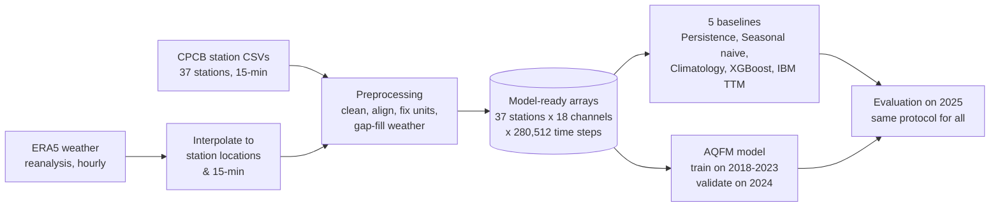
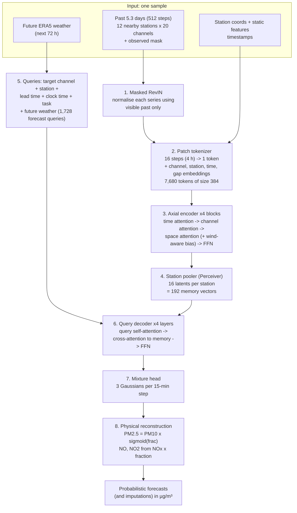

# AQFM: Air Quality Forecasting for Delhi, a Complete Project Walkthrough

**Project:** Honours project by Phalak Mehta. *Air Quality Forecasting using Foundation Models: a spatio-temporal deep-learning approach for multi-pollutant forecasting in Delhi.*
**Document date:** 11 October 2026
**Purpose:** Explain the whole project from start to finish in plain language, one component at a time, with the most detail on the model architecture. Each numbered section is meant to become one or more slides; a suggested slide outline is at the end (§15).

> **Status in one line:** the data pipeline is built and verified, five baselines have been run honestly, and the AQFM model is fully implemented and tested (31 passing tests). **It has not been trained yet** because training needs a GPU. So this document describes *how the system works*, not how well AQFM performs. No AQFM accuracy numbers exist yet.

Companion documents:
- [DATA_REPORT.md](DATA_REPORT.md): everything about the data (sources, coverage, statistics, quality issues).
- [BOTTLENECKS_AND_IMPROVEMENTS.md](BOTTLENECKS_AND_IMPROVEMENTS.md): what limits the project and how to fix it.
- [../PROJECT_CONTEXT.md](../PROJECT_CONTEXT.md): the detailed technical log (bugs, roadmap, commands).

---

## Contents

1. [The problem](#1-the-problem)
2. [Goals and how success is measured](#2-goals-and-how-success-is-measured)
3. [The system at a glance](#3-the-system-at-a-glance)
4. [Component 1: Data collection](#4-component-1-data-collection)
5. [Component 2: Preprocessing](#5-component-2-preprocessing)
6. [Component 3: Baselines](#6-component-3-baselines)
7. [Component 4: The AQFM architecture](#7-component-4-the-aqfm-architecture)
8. [Component 5: Training](#8-component-5-training)
9. [Component 6: Evaluation](#9-component-6-evaluation)
10. [Verification and testing](#10-verification-and-testing)
11. [Problems found and fixed along the way](#11-problems-found-and-fixed-along-the-way)
12. [Current status and roadmap](#12-current-status-and-roadmap)
13. [Repository layout and how to run](#13-repository-layout-and-how-to-run)
14. [Glossary](#14-glossary)
15. [Suggested slide outline](#15-suggested-slide-outline)

---

## 1. The problem

Delhi has some of the worst air in the world. Across 37 monitoring stations from 2018 to 2025, the **average PM2.5 concentration was 102.9 µg/m³**. The Indian "Good" band ends at 30. In November, about **31% of all station readings were in the "Severe" band (PM2.5 above 250 µg/m³)**. All figures come from [DATA_REPORT.md](DATA_REPORT.md).

People and authorities need to know **what the air will be like over the next 1 to 72 hours**, so that they can issue health warnings, restrict traffic or construction, or close schools. That is a forecasting problem, and it has three properties that make it hard:

| Difficulty | What it means |
|---|---|
| **It depends on space** | Pollution moves with the wind. A station that is upwind now tells you something about your station a few hours from now. |
| **It depends on weather** | On cold, still winter nights the atmosphere's mixing layer (the *boundary-layer height*) can fall below 150 m. Pollution is then trapped near the ground and concentrations spike. |
| **The data is messy** | Stations go offline for hours or days, sensors fail one at a time, units are inconsistent, and some readings are impossible. |

The CPCB grades PM2.5 into six AQI bands. These are used throughout the project:

| Band | PM2.5 (µg/m³) |
|---|---|
| Good | 0–30 |
| Satisfactory | 30–60 |
| Moderate | 60–90 |
| Poor | 90–120 |
| Very Poor | 120–250 |
| **Severe** | **≥ 250** |

## 2. Goals and how success is measured

**Main goal:** build a model that forecasts several pollutants at every station, from 15 minutes to 72 hours ahead, and that:

1. **Beats the strongest simple baseline.** That is XGBoost, at **38.63 µg/m³ MAE for PM2.5 at 24 hours** on the 2025 test year.
2. **Does well where it matters most:** the Severe band. Every baseline currently misses severe hours by 105–120 µg/m³ on average.
3. **Says how confident it is.** It outputs a full probability distribution, not just one number, and its "90% intervals" should really contain the truth about 90% of the time.
4. **Can fill in missing data** (imputation) when a station goes offline.

**Test setup (the same for every model):** the model is trained on 2018–2023, tuned on 2024, and tested once on **2025**, which it never sees during training. A forecast is made every day at midnight (IST) for every station, and is scored at 1 h, 6 h, 24 h and 72 h ahead.

## 3. The system at a glance



There are six components:

| # | Component | Code | In one sentence |
|---|---|---|---|
| 1 | Data collection | `data_pipeline/fetch_era5.py`, `fix_era5_zips.py`, `interpolate_era5_to_stations.py`, `generate_stations_csv.py` | Gets the air-quality and weather data and places the weather at each station. |
| 2 | Preprocessing | `data_pipeline/preprocess_aqfm.py` | Turns hundreds of messy CSV files into a few clean arrays. |
| 3 | Baselines | `baselines/` | Simple and established forecasters that AQFM has to beat. |
| 4 | AQFM model | `aqfm/model.py`, `layers.py`, `physical.py` | The new neural network. |
| 5 | Training | `aqfm/train.py`, `masking.py`, `losses.py`, `data.py` | Teaches the model to forecast and to fill gaps. |
| 6 | Evaluation | `aqfm/evaluate.py`, `baselines/baseline_utils.py` | Scores everything the same way on 2025. |

---

## 4. Component 1: Data collection

### 4.1 Air-quality data (CPCB)

- **Source:** India's Central Pollution Control Board (CPCB) continuous monitoring stations in Delhi. The stations are run by CPCB, DPCC (Delhi Pollution Control Committee) and IITM (Indian Institute of Tropical Meteorology).
- **Format:** one CSV per station per year in `data/yearly_data/<year>/`, with a reading every **15 minutes**. The folder holds 427 files covering 2009–2026; the project uses **2018–2025**.
- **What each station measures:** pollutants (PM2.5, PM10, NO, NO2, NOx, NH3, SO2, CO, Ozone, Benzene and more) and local weather (temperature, humidity, wind speed and direction, solar radiation, pressure, rainfall).
- **Station locations** (`data/stations.csv`): latitude and longitude, obtained by **geocoding the station names** with OpenStreetMap's Nominatim service (`generate_stations_csv.py`). 38 stations are listed; 37 have data. *Known issue: three stations fell back to a default "Delhi centre" coordinate (see [BOTTLENECKS_AND_IMPROVEMENTS.md](BOTTLENECKS_AND_IMPROVEMENTS.md)).*

### 4.2 Weather data (ERA5)

- **What ERA5 is:** a *reanalysis* from the European Centre for Medium-Range Weather Forecasts. It is a physically consistent, gap-free reconstruction of past weather on a ~0.25° grid, every hour.
- **Why it is needed:** (a) CPCB weather sensors are often missing; for example, only 57% of temperature readings exist. (b) ERA5 provides the **boundary-layer height (BLH)**, which no ground station measures and which matters a great deal for pollution.
- **Variables downloaded (8):** 2 m temperature, 2 m dew point, 10 m wind (u and v), solar radiation, surface pressure, total precipitation, boundary-layer height.
- **Pipeline:**
  1. `fetch_era5.py` downloads one NetCDF file per month for a box around Delhi, through the Copernicus API (100 months, 2017-01 to 2025-12, 35 MB).
  2. `fix_era5_zips.py` unpacks files that the API returned as zip archives disguised as `.nc` files.
  3. `interpolate_era5_to_stations.py` interpolates the grid **bilinearly to each station location**, then **upsamples from hourly to 15-minute** steps. Only the three slots inside each hour are filled, so a missing month stays missing instead of being invented. Output: `data/era5_interpolated.parquet` (730 MB).

## 5. Component 2: Preprocessing

`data_pipeline/preprocess_aqfm.py` turns raw files into **model-ready arrays**. It runs in about 2.5 minutes and has six steps:

| Step | What happens | Why |
|---|---|---|
| **1. Load and align** | Read every CSV for 2018–2025 and put every station on one shared 15-minute timeline (280,512 steps). Duplicate timestamps are averaged. | Models need a regular grid. |
| **1b. Fix pressure units** | Any pressure reading above 900 is converted from hPa to mmHg (× 0.750062). | About half the stations report hPa even though the column says mmHg. 5.4 million readings were converted. |
| **2. Merge ERA5** | Shift ERA5 from UTC to Indian time (+5 h 30 min). Where a station's own weather sensor is missing, fill the gap from ERA5; never overwrite a real reading. Add BLH as an extra channel. Also save a separate pure-ERA5 weather array for the model's "future weather" input. | Weather gaps would otherwise cripple the forecasts. The time shift fixes a 5.5-hour misalignment. |
| **3. Sanity checks** | Readings outside physical limits (e.g. PM2.5 > 2000, humidity > 100%) are marked missing. Rows where PM2.5 > PM10 are counted (36,914) but kept. | Removes impossible values. |
| **4. Build arrays** | Timestamps (hours since 2018-01-01) and station coordinates. | |
| **5. Static features** | 4 fixed numbers per station: average pollution level, typical PM2.5/PM10 ratio, an elevation proxy from pressure, and station density within 5 km. | Gives the model a "personality" for each station. *(A bug that left the density feature at zero for 36 of 37 stations was fixed on 11 Oct 2026.)* |
| **6. Report** | Coverage per channel and year, fill counts and outlier counts are written to `preprocessing_report.json`. | Makes the data auditable. |

**Output (`data/preprocessed/`):**

| File | Shape | Meaning |
|---|---|---|
| `values.npy` | (37, 18, 280512) | Measurements: 37 stations × 18 channels × 280,512 fifteen-minute steps. Missing = 0. |
| `observed.npy` | (37, 18, 280512) | 1 where a reading is real, 0 where it is missing. **This mask is central**: the model always knows what is real and what is not. |
| `era5_met.npy` | (37, 8, 280512) | Pure ERA5 weather in IST (temperature, humidity, wind u/v, sun, pressure, rain, BLH). |
| `timestamps_h.npy` | (280512,) | Time in hours. |
| `coords.npy`, `static.npy` | (37, 2), (37, 4) | Location and static features. |

The 18 channels are: **PM2.5, PM10, NO2, NOx, NO, Ozone, SO2, NH3, CO** (9 pollutants), **AT, RH, WS, WD, SR, BP, TOT_RF** (temperature, humidity, wind speed, wind direction, solar radiation, pressure, rainfall), **Benzene**, and **BLH**.

---

## 6. Component 3: Baselines

A baseline is a simpler method that the new model must beat. If a complex model cannot beat a simple one, the complexity is not justified. Five baselines were run on exactly the same test protocol:

| Baseline | How it forecasts | Type |
|---|---|---|
| **Persistence** | "Tomorrow will be like right now." Uses the last observed value. | Naive |
| **Seasonal naive** | "Tomorrow at 3 pm will be like today at 3 pm." Uses the value 24 h earlier. | Naive |
| **Climatology** | Average for this station, hour of day and month, computed from training years. | Statistical |
| **XGBoost** | Gradient-boosted trees using recent pollution (1 h to 72 h ago), recent weather, the other PM type, and the calendar. One model per (pollutant, horizon). | Machine learning |
| **IBM Granite TTM** | A pretrained time-series foundation model, used zero-shot (no training on Delhi data). | Foundation model |

**Results on 2025 (MAE in µg/m³; lower is better):**

| Model | PM2.5 1 h | PM2.5 6 h | **PM2.5 24 h** | PM2.5 72 h | PM10 24 h |
|---|---|---|---|---|---|
| Persistence | **15.89** | 35.53 | 43.78 | 54.54 | 84.64 |
| Seasonal naive | 43.17 | 39.87 | 43.60 | 43.84 | 84.18 |
| Climatology | 44.83 | 43.30 | 43.79 | 44.04 | 82.76 |
| XGBoost | 18.17 | **30.06** | **38.63** | 43.74 | 73.65 |
| IBM TTM (zero-shot)\* | 20.23 | 32.43 | 37.70 | **41.32** | **71.74** |

**PM2.5 at 24 h in the Severe band (> 250 µg/m³):** Climatology 105.8, XGBoost 110.5, TTM 112.4, Seasonal naive 117.4, Persistence 119.3. **Every method is worst exactly where it matters most.** This is the opening for AQFM.

\* TTM is scored on hourly averages while the others are scored on 15-minute points, which gives TTM a slightly easier target. TTM was also verified to **ignore weather completely**: scrambling its weather inputs changed its PM forecasts by exactly 0. It is effectively a single-variable forecaster. This motivates AQFM's cross-channel and cross-station attention.

**The bar to beat: XGBoost, PM2.5 at 24 h = 38.63 µg/m³.**

---

## 7. Component 4: The AQFM architecture

### 7.1 The idea in plain words

Think of a weather forecaster looking at a big wall of charts. Each chart is one sensor at one station over the past few days. The forecaster:

1. Breaks each chart into **4-hour chunks** and summarises each chunk (*tokenization*).
2. Looks **along time** ("how has this sensor been trending?"), **across sensors** ("PM10 is rising and humidity is high, so PM2.5 will probably rise"), and **across stations, taking the wind into account** ("the station 8 km upwind spiked two hours ago") (*axial encoder*).
3. Writes a short **summary note per station** (*station pooler*).
4. Answers specific **questions** such as "What will PM10 be at station X, 30 hours from now?" (*query decoder*).
5. Gives each answer as a **range of likely values with probabilities**, not one number (*mixture head*).
6. Makes sure the answers obey **physics**: PM2.5 can never exceed PM10 (*physical reparameterisation*).

### 7.2 Architecture diagram



### 7.3 What one training example looks like

AQFM does not look at all 37 stations at once. Each example is a **neighbourhood**:

| Item | Value | Meaning |
|---|---|---|
| Stations | **12**: an anchor station plus its 11 nearest neighbours | Pollution is local, and this keeps memory manageable. The farthest of the 11 neighbours is a median 8.3 km from the anchor. |
| Context (past) | **512 steps = 128 h ≈ 5.3 days** = 32 patches of 4 h | What the model sees. |
| Horizon (future) | **288 steps = 72 h** = 18 patches of 4 h | What the model predicts. |
| Input channels | **20** (see below) | |

**The 20 input channels.** The 18 stored channels are transformed into 20 model channels:

- **9 pollutants:** PM2.5, PM10, NO2, NOx, NO, Ozone, SO2, NH3, CO.
- **Weather:** temperature (AT), humidity (RH), **wind as U and V components** (east-west and north-south), solar radiation (SR), pressure (BP), rainfall (TOT_RF), boundary-layer height (BLH). Wind is converted from speed and direction to U/V because directions cannot be averaged: 350° and 10° would average to 180°, the opposite direction.
- **Benzene.**
- **2 physical fractions:** `PM_FRAC` = logit(PM2.5 / PM10) and `NOX_FRAC` = logit(NO / NOx), with both NO and NOx in ppb. A fraction is marked as observed only when all of its ingredients are observed.

Skewed, non-negative channels (pollutants, rain, benzene, BLH) are put through `log(1 + x)`, which tames extreme values.

### 7.4 The eight building blocks

#### ① Masked RevIN: normalisation that cannot cheat (`layers.py: MaskedRevIN`)

- Every (example, station, channel) series is rescaled to mean 0 and standard deviation 1, **using only the visible past values**.
- Why "only the past": if the future were included, the scale of the answer would leak into the input.
- **Safety nets:** if fewer than 16 values are visible (a long outage), global statistics from the training years are used instead. The standard deviation is never allowed below 10% of the global one, so a stuck sensor cannot blow the numbers up.

#### ② Patch tokenizer: from numbers to tokens (`model.py: PatchTokenizer`)

- Every **16 consecutive steps (4 hours)** of one channel at one station become **one token**: a vector of 384 numbers.
- One sample therefore has 12 stations × 20 channels × 32 patches = **7,680 tokens**.
- Each token is the **sum** of:

| Ingredient | What it tells the model |
|---|---|
| Linear projection of the 16 values **and their 16 observed flags** | The data, and which parts of it are real. |
| Channel embedding | "I am PM10" or "I am humidity". |
| Station MLP of (latitude, longitude, 4 static features) | "I am station X." Using coordinates instead of an ID table means a **new station could be added** without retraining. |
| Fourier time features | Time of day, day of week and season, from 6 log-spaced cycles (3 h to 1 year) plus exact daily, weekly and yearly cycles. |
| Gap feature: log(1 + hours since this series was last observed) | Distinguishes "the next patch" from "the next patch after a 10-hour outage". |

- A patch with **no observed values at all** is excluded from attention entirely, rather than being treated as a real zero.

#### ③ Axial encoder: three kinds of attention (`layers.py: AxialBlock`, ×4 blocks)

*Attention* lets every token look at other tokens and decide which ones matter. Letting all 7,680 tokens look at each other would cost 7,680² ≈ 59 million pairs per head. The **axial** trick splits this into three cheap passes:

| Pass | Each token looks at… | Learns… |
|---|---|---|
| **Time attention** | the other 31 patches of the *same* channel at the *same* station | trends and daily cycles |
| **Channel attention** | the other 19 channels at the *same* station and *same* 4-h patch | relationships such as PM10 ↔ PM2.5, or humidity → haze |
| **Space attention** | the *same* channel and *same* patch at the other 11 stations | how pollution spreads across the city |

Then a feed-forward layer (384 → 1536 → 384). Each pass uses pre-normalisation and a residual connection. Hidden or missing tokens are masked out of every pass.

**The wind-aware spatial bias (`layers.py: SpatialBias`)** is the most domain-specific part. Before space attention, every pair of stations (i, j) gets an extra score for each attention head, computed by a small neural network from:

- the distance between them, as log(1 + d) and exp(−d / 25 km);
- the **angle between "the direction from i to j" and "the direction the wind is coming from at i"**, as cos and sin;
- the wind speed, and cos × wind speed.

When cos = 1, station j is **directly upwind** of station i. The model can therefore learn that "an upwind station 8 km away matters more than a downwind one at the same distance", which a plain distance-based graph cannot express. The wind is computed per 4-h patch from the U/V channels, so the bias changes as the wind changes. Ablation switches: `distance` (no wind) or `none`.

#### ④ Station pooler: a short summary per station (`model.py: StationPooler`)

- Each station's 20 × 32 = 640 tokens are compressed into **16 "latent" vectors** by a Perceiver-style cross-attention: 16 learned questions read the 640 tokens.
- The latents carry the station's identity, so the decoder can tell stations apart.
- Result: 12 stations × 16 = **192 memory vectors**. This bottleneck is what makes decoding affordable.

#### ⑤ Queries: asking the model a question (`model.py: AQFM.embed_queries`)

Instead of a fixed output layer, AQFM is **asked questions**. Each query is the sum of:

| Part | Example |
|---|---|
| Target slot (which output channel) | "PM10" |
| Task | forecast or impute |
| **Lead time**, continuous and signed, in hours | +30 h (a negative value means "fill in the past") |
| Station MLP (coords + static) | "at station X" |
| Clock time (Fourier features) | "on a Tuesday night in December" |
| **Future ERA5 weather** for that 4-h patch (switchable) | "when BLH will be 120 m and the wind 1 m/s" |

**Forecast queries** form a full grid: 12 stations × 8 target slots × 18 future patches = **1,728 queries**. **Imputation queries** ask about up to 48 hidden (station, past patch) positions.

The **8 target slots** are PM10, PM_FRAC, NOx, NOX_FRAC, Ozone, SO2, CO and NH3. PM2.5, NO and NO2 are rebuilt from these (see ⑧).

Why this design matters: one set of weights serves **any pollutant, any station, any horizon and both tasks**. The continuous lead time also means the model is not tied to fixed horizons.

#### ⑥ Query decoder (`model.py: QueryDecoder`, ×4 layers)

Each layer has three steps:
1. **Query self-attention:** the queries talk to each other. For example, the PM10 query and the PM2.5-fraction query for the same station and hour can agree before answering.
2. **Cross-attention to the 192 memory vectors:** each query reads what it needs from the encoded past.
3. **Feed-forward layer.**

#### ⑦ Mixture head: answers with uncertainty (`model.py: MixtureHead`)

- For every query, and for **each of the 16 fifteen-minute steps** in its 4-h patch, the head outputs a **mixture of 3 Gaussian (bell) curves**: 3 weights, 3 centres and 3 widths.
- Because this is in log space, it corresponds to a mixture of **log-normal** distributions in µg/m³, which suits skewed pollution data.
- Why a mixture: one curve cannot say "probably about 80, but there is a real chance of 300 if the inversion holds". Three curves can.
- At evaluation, 200 samples are drawn and their **median** is the point forecast. The spread gives the uncertainty intervals.

#### ⑧ Physical reparameterisation (`physical.py`)

The model never predicts PM2.5 directly. It predicts **PM10** and a **fraction**:

> **PM2.5 = PM10 × sigmoid(PM_FRAC)**, where sigmoid always gives a number between 0 and 1.
> **NO = NOx × f, NO2 = NOx × (1 − f)**, computed in ppb and converted back to µg/m³.

So **PM2.5 ≤ PM10 is guaranteed for every forecast**, and NO + NO2 = NOx holds exactly. A naive model can break both rules.

### 7.5 Shapes, step by step (one batch of B examples)

| Stage | Tensor shape |
|---|---|
| Input values and mask | (B, 12 stations, 20 channels, 512 steps) |
| After tokenizer | (B, 12, 20, 32 patches, 384) |
| After 4 axial blocks | (B, 12, 20, 32, 384) |
| After station pooler | (B, 192, 384) |
| Forecast queries | (B, 1728, 384) |
| After decoder | (B, 1728, 384) |
| Mixture head output | 3 tensors of (B, 1728, 16 steps, 3 components) |

### 7.6 Size

Full configuration: d_model = 384, 8 heads, FFN 1536, 4 encoder blocks, 4 decoder layers, 16 latents per station, 3 mixture components, dropout 0.1.

| Part | Parameters |
|---|---|
| Axial encoder (4 blocks) | 11.83 M |
| Query decoder (4 layers) | 9.47 M |
| Station pooler | 1.93 M |
| Query embedders | 0.32 M |
| Tokenizer | 0.18 M |
| Mixture head | 0.06 M |
| Wind-aware spatial bias | < 0.01 M |
| **Total** | **23.79 M** |

All counts were measured from the code. A small configuration (`AQFMConfig.small()`) is used for tests and CPU debugging.

### 7.7 What is new compared with the baselines

| Capability | Persistence / Climatology | XGBoost | IBM TTM | **AQFM** |
|---|---|---|---|---|
| Uses other stations | ✗ | ✗ | ✗ | **✓ (wind-aware)** |
| Uses weather | ✗ | past only | ✗ (verified) | **✓ past + future ERA5** |
| Uses boundary-layer height | ✗ | ✗ | ✗ | **✓** |
| Handles missing data natively | partly | zero-filled | forward-filled | **✓ mask-aware** |
| Uncertainty / probabilities | ✗ | ✗ | ✗ | **✓ mixture** |
| Physics constraints | ✗ | ✗ | ✗ | **✓ PM2.5 ≤ PM10** |
| Fills gaps (imputation) | ✗ | ✗ | ✗ | **✓** |
| One model for all pollutants and horizons | ✗ | ✗ (8 models) | ✓ | **✓** |

---

## 8. Component 5: Training

### 8.1 Data splits (by date, never shuffled)

| Split | Period | Use |
|---|---|---|
| Train | 2018–2023 (no training window's future reaches 2024) | learning |
| Validation | 2024: 512 fixed random windows (seed 12345) | choosing the best checkpoint, early stopping |
| Test | 2025 | final scoring only, touched once |

All statistics (normalisation fallbacks, weather scaling, outage lengths) are computed from the training years only.

### 8.2 Masking curriculum: practising for real failures

Each training example is corrupted in one of three ways before the model sees it. This teaches the model both to forecast and to cope with broken stations:

| Regime | Share | What is hidden in the past | Teaches |
|---|---|---|---|
| **Tail** | 50% | nothing | plain forecasting |
| **Block** | 35% | 1–4 **station-wide outages** of the pollution analysers. Lengths are drawn from a log-normal distribution **fitted to real Delhi outages** (median ≈ 12.8 h, from 3,033 real outages ≥ 4 h) | surviving outages, and filling them in |
| **Channel** | 15% | a random 20–60% of pollutants at each station, over a random window | predicting PM2.5 from weather and neighbours |

Rules:
- **The full 72-hour future is always a forecasting target**, so every lead time is trained equally. (The original code trained 4-hour-ahead leads on only 3.9% of examples.)
- Weather is **never** hidden, because ERA5 is always available.
- A fraction is hidden whenever any of its ingredients is hidden. Otherwise PM10 × fraction would reveal a hidden PM2.5.
- Hidden cells that were really observed become **imputation targets** and are scored separately from forecasts.

### 8.3 Loss: what the model is rewarded for

No mean-squared error is used anywhere. Air-quality decisions depend on thresholds, so a well-calibrated upper tail matters more than an average.

| Term | Weight | Meaning |
|---|---|---|
| **NLL** (negative log-likelihood) | 1.0 | "How probable did you consider the true value?" |
| **CRPS**, exact closed form | 0.5 | Rewards distributions that are both sharp and correct. Computed exactly, with no sampling noise. |
| **Physical CRPS** | 0.25 | 32 samples → rebuild PM2.5, NO and NO2 → score them against the truth. This is how **PM2.5, the headline metric, is trained directly**. |

### 8.4 Two training phases

| Phase | Masking | Learning rate | Command |
|---|---|---|---|
| 1. Main | mixed (tail / block / channel) | 3e-4 | `python -m aqfm.train --phase main --out runs/main --grad-checkpoint --device cuda` |
| 2. Anneal | none (pure forecasting) | 5e-5 | `python -m aqfm.train --phase anneal --init runs/main/best.pt --out runs/anneal --device cuda` |

**Optimiser details:** AdamW (β = 0.9, 0.95; weight decay 0.05, not applied to biases, norms or embeddings), 2,000 warm-up steps followed by a cosine decay to 1% of the base rate, gradient clipping at 1.0, batch size 8, bf16 mixed precision on a GPU, optional gradient checkpointing. Validation runs every 1,000 steps; `best.pt` is saved on validation NLL + 0.5 × CRPS, with early stopping after 10 validations without improvement.

## 9. Component 6: Evaluation

`aqfm/evaluate.py` uses **the same metric functions as the baselines** (it imports `baselines/baseline_utils.py`), so the comparison is like-for-like:

- **Test origins:** every day at 00:00 IST in 2025 (362 days) × 37 stations = **13,394 forecasts**. Each station is forecast as the anchor of its own neighbourhood.
- **Point metrics:** MAE and RMSE at 1 h, 6 h, 24 h and 72 h for PM2.5 and PM10, on 15-minute points where the truth was observed.
- **AQI-band MAE** at 24 h.
- **Episode detection:** precision, recall and F1 for PM2.5 > 250 at 24 h and 48 h.
- **Probabilistic metrics:** CRPS by lead hour, PIT histograms (is the model over- or under-confident?), and 90% / 95% interval coverage.
- **Imputation test:** hide a 24-hour station outage and compare AQFM's fill-in with straight-line interpolation.

**The three numbers that decide the result:** (a) PM2.5 24 h MAE versus XGBoost's 38.63; (b) Severe-band MAE and episode recall; (c) whether 90% intervals really cover about 90%.

---

## 10. Verification and testing

`tests/test_aqfm.py` contains **31 tests, all passing** (`python -m pytest tests -q`, about 30 s on a CPU). Highlights:

- **No-leakage test:** change the future values and confirm that the encoder output is bit-for-bit identical.
- Normalisation uses visible cells only; input and target masks never overlap; outages are station-wide; every lead time is a target.
- The loss functions match references: exact CRPS equals Monte Carlo CRPS; NLL equals PyTorch's built-in distributions; there is no gradient from unobserved targets.
- Wind geometry: an upwind station gives cos = 1. Reordering the stations gives the same answers.
- The model can overfit a fixed batch (so it can learn); every ablation configuration runs; the evaluation pipeline runs end to end.
- **Mutation testing:** 6 deliberately planted bugs (wrong ratio space, leaking normalisation, horizon shifted into the context, CRPS sign flipped, wind direction flipped, missing visibility rule) were **each caught** by a test.

## 11. Problems found and fixed along the way

Finding these was a substantial part of the project, and each one would have produced wrong results:

| # | Problem | Effect | Fix |
|---|---|---|---|
| 1 | **Fabricated weather.** ERA5 for Apr 2017 – Dec 2020 had never been downloaded, and linear interpolation drew a straight line across the 3.75-year hole. | 2018–2020 "weather" was fake: 12.5 °C at noon in June, no sunlight for 3 years. | Downloaded the missing 37 months; interpolation can no longer bridge gaps. |
| 2 | **Time-zone mismatch.** ERA5 is in UTC, CPCB in IST. | All gap-filled weather was 5.5 h out of phase (solar peak at 7 am). | Shift ERA5 by +5:30; solar radiation now peaks at noon. |
| 3 | **Mixed pressure units** (hPa vs mmHg). | Pressure jumped 980 ↔ 735 within a station. | Per-value conversion (5.4 M readings). |
| 4 | **XGBoost used the future.** PM2.5 forecasts were clipped using the *observed future* PM10. | The headline baseline looked 2.5 µg/m³ better than it really was. | Clip removed; honest number is 38.63 (was 36.15). |
| 5 | **Out-of-memory** in preprocessing. | Crashed on 16 GB RAM. | Read the parquet one station at a time. |
| 6 | **12 bugs in the original model code** (`files_AqFM/`), e.g. PM2.5 was never trained, ratios in the wrong space, short lead times barely trained, data modified in place. | The original model could not have produced valid results. | All fixed in the new `aqfm/` package; the original is kept frozen for reference. |

## 12. Current status and roadmap

| Stage | Status |
|---|---|
| A. Data pipeline rebuilt and verified | ✅ done |
| B. Honest baselines | ✅ done |
| C. Train AQFM | ⬜ **blocked on GPU access**. On this CPU-only laptop one full-size training step takes too long for real training (see [BOTTLENECKS_AND_IMPROVEMENTS.md](BOTTLENECKS_AND_IMPROVEMENTS.md)). |
| D. Evaluate on 2025, ≥ 3 seeds | ⬜ |
| E. Ablations: no future weather (oracle gap), no BLH, no spatial attention, distance-only bias, no physics, random-only masking | ⬜ switches already built (except no-BLH) |
| F. Compare with published models: PatchTST / iTransformer, AirFormer, AirPhyNet, E-STGCN | ⬜ |
| G. Write-up | ⬜ |

**On naming:** the implementation plan recommends **not** calling AQFM a "foundation model" until it is pre-trained on many regions and shown to transfer. On Delhi-only data, "spatio-temporal multi-pollutant forecasting model" is the defensible description.

## 13. Repository layout and how to run

```
Foundation Model/
├── README.md                 entry point
├── PROJECT_CONTEXT.md        detailed technical log and roadmap
├── CLAUDE.md                 working rules for AI assistants
├── aqfm/                     the model package (config, layers, model, losses, masking, physical, data, train, evaluate)
├── tests/                    31 tests for aqfm/
├── data_pipeline/            ERA5 download/fix/interpolate, station geocoding, preprocessing
├── baselines/                5 baselines + shared metrics (results/ holds the JSON results)
├── data/                     all data (gitignored except stations.csv)
│   ├── yearly_data/          raw CPCB CSVs
│   ├── era5_data_raw/        monthly ERA5 NetCDFs
│   ├── era5_interpolated.parquet
│   ├── preprocessed/         model-ready arrays
│   └── stations.csv
├── docs/                     this document, data report, bottlenecks, plans, figures/
├── presentation/             slide-deck builder (pptxgenjs) and the presented PDF
├── benchmark_gpu.py          measures training speed and memory on the current device
├── requirements.txt          exact package versions
├── files_AqFM/               original reference model and design spec (frozen)
└── _archive_old/             superseded material (gitignored)
```

```bash
# from the repository root
pip install -r requirements.txt                     # exact package versions used for every result
python data_pipeline/fetch_era5.py                  # download ERA5 2021-01..2025-12 (Copernicus account needed)
python -c "import sys; sys.path.insert(0,'data_pipeline'); from fetch_era5 import fetch_month; [fetch_month(y,m,'data/era5_data_raw') for y,m in [(2017,12)]+[(y,m) for y in (2018,2019,2020) for m in range(1,13)]]"
                                                    # ...and 2017-12..2020-12 (the script's loop covers only 2021-2025)
python data_pipeline/fix_era5_zips.py               # unpack zip-in-.nc files
python data_pipeline/interpolate_era5_to_stations.py
python data_pipeline/preprocess_aqfm.py             # -> data/preprocessed/ (edit ROOT at the top if the repo is elsewhere)
cd baselines && python run_baselines_classical.py && python run_baselines_xgboost.py && python run_baselines_xgboost.py --future-met && python run_baselines_ttm.py && cd ..
python docs/data_report_stats.py                    # every number in DATA_REPORT.md -> docs/data_report_stats.json
python -m pytest tests -q
python -m aqfm.train --phase main --out runs/main --grad-checkpoint --device cuda
python -m aqfm.train --phase anneal --init runs/main/best.pt --out runs/anneal --device cuda
python -m aqfm.evaluate --ckpt runs/anneal/best.pt --out results/aqfm_results.json --device cuda --seed 0
```

`data/stations.csv` is a fixed input: it was geocoded once (`generate_stations_csv.py`), and geocoding again could return different coordinates. Always use the committed file.

## 14. Glossary

| Term | Meaning |
|---|---|
| **PM2.5 / PM10** | Particles smaller than 2.5 / 10 micrometres. PM2.5 reaches deep into the lungs. |
| **µg/m³** | Micrograms per cubic metre: the unit of concentration. |
| **ERA5 / reanalysis** | A computer reconstruction of past weather that blends observations with a physics model. |
| **BLH (boundary-layer height)** | Height of the lowest, well-mixed layer of air. Low BLH traps pollution. |
| **IST / UTC** | Indian Standard Time = UTC + 5 h 30 min. |
| **MAE / RMSE** | Average absolute error / root of the average squared error (RMSE punishes big misses more). |
| **CRPS** | Continuous Ranked Probability Score: the error of a whole forecast distribution. It equals MAE when the forecast is a single number. |
| **NLL** | Negative log-likelihood: how surprised the model was by the truth. |
| **PIT histogram** | A calibration check. A flat histogram means the model's uncertainty is right. |
| **Token** | One small chunk of input turned into a vector (here: 4 h of one sensor at one station). |
| **Attention** | A mechanism that lets each token weigh how relevant every other token is. |
| **Axial attention** | Attention done one axis at a time (time, then channel, then space) to save compute. |
| **Perceiver / latents** | A small set of learned vectors that summarise a large set of tokens. |
| **RevIN** | Reversible instance normalisation: rescale each input series and undo the scaling on the output. |
| **Imputation** | Filling in missing past values. |
| **Ablation** | Removing one component and retraining to measure how much it helped. |
| **Oracle gap** | How much better the model looks when given *real* future weather (reanalysis) instead of a *forecast* of it. |
| **Leakage** | Accidentally letting a model see information from the future. It makes results look better than they are. |

## 15. Suggested slide outline

| # | Slide | Source section |
|---|---|---|
| 1 | Title | — |
| 2 | Delhi's air-quality problem (avg 102.9 µg/m³; 31% of November readings Severe) | §1, Data report |
| 3 | Why forecasting is hard: space, weather, messy data | §1 |
| 4 | Goals and success criteria | §2 |
| 5 | System overview diagram | §3 |
| 6 | Data sources: CPCB + ERA5, 37 stations, 8 years, 15-min | §4 |
| 7 | Data insights: seasonality, daily cycle, BLH link (figures) | Data report |
| 8 | Preprocessing pipeline (6 steps) | §5 |
| 9 | Data problems we caught (fabricated weather, time zone, units, leakage) | §11 |
| 10 | Baselines and honest results; the bar to beat = 38.63 | §6 |
| 11 | Severe band: every baseline fails here | §6 |
| 12 | AQFM idea in plain words (the forecaster analogy) | §7.1 |
| 13 | Architecture diagram | §7.2 |
| 14 | Tokens: what a 4-hour patch token contains | §7.4 ② |
| 15 | Axial encoder + wind-aware spatial bias (upwind diagram) | §7.4 ③ |
| 16 | Station pooler + query decoder ("asking questions") | §7.4 ④–⑥ |
| 17 | Probabilistic output + physics constraint (PM2.5 ≤ PM10) | §7.4 ⑦–⑧ |
| 18 | Comparison table: AQFM vs baselines (capabilities) | §7.7 |
| 19 | Training: masking curriculum + loss | §8 |
| 20 | Evaluation protocol + the three deciding numbers | §9 |
| 21 | Verification: 31 tests + mutation testing | §10 |
| 22 | Status, bottlenecks, roadmap | §12, Bottlenecks doc |
| 23 | Conclusion | — |
